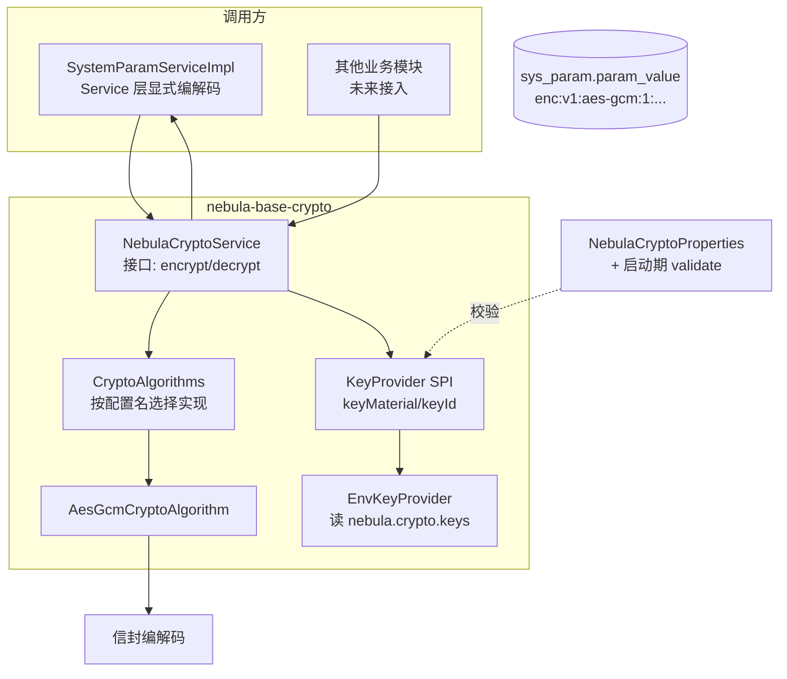

# 全局敏感字段加密设计（nebula-base-crypto）— 设计稿

> 状态：**已实施**（2026-10-15）。实现在 `nebula-base/nebula-base-crypto`，运维手册见该模块 `README.md`，规范落地见 `docs/spec/09-security.md` §3.4。
> 本文档保留为设计依据与决策记录；**实现细节以代码与该模块 README 为准**，已知与本文的差异：包名为 `cn.cloudomni.nebula.crypto`（全仓 base 模块统一 `cn.cloudomni.nebula.{module}`，不存在 `cn.cloudomni.nebula.base.*`）、生产开关的真实键名是 `nebula.auth.code.log-enabled`（§10 第 4 项写作 `login.code-log-enabled`）。
> 决策（2026-10-15）：① **不引入非对称加密**（评估见 §14.2，后续如需要再单独评估改造）；② **不引入国密 SM4**，算法只做 AES-256-GCM
> 范围：新增基础能力模块 `nebula-base-crypto`（JCE AES-256-GCM 单密钥对称加密）+ `sys_param.is_encrypted` 自描述标记 + 前端 `EncryptedValueField` 组件 + 敏感数据暴露面治理
> 关联：`docs/spec/01-architecture.md`（模块与分层）、`docs/spec/04-database.md`（DDL/命名）、`docs/spec/07-exception.md`（错误码）、`docs/spec/09-security.md`（安全）、`docs/spec/10-config.md`（配置）、`docs/spec/08-logging.md`（脱敏）
> 验证：§3.9 的 14 项密码学流程断言已在 JDK 21.0.9 / SunJCE 上实跑通过（一次性验证脚本，未入库；实施时按 §12 落为单测）

---

## 0. 摘要

参数中心已经承担了运行期配置的职责，`sys_param.param_value` 里存放着 SMTP 授权码、初始密码等**明文机密**（`docs/sql/init/mysql/02-init-data.sql:1048`、`:1072`）。当前唯一防线是"接口不回填明文"这类前端约定，**数据库、备份、日志、缓存四处全是明文**。

本设计提供一条**最小、可扩展、无外部依赖**的加密通道：

| 决策 | 取值 | 理由 |
|---|---|---|
| 算法 | AES-256-GCM（AEAD） | JDK 内置，同时提供机密性与完整性，无需额外的 MAC 组合 |
| 密钥 | **配置的一把密钥直接作为 AES 密钥**，不做 KDF 派生 | 见 §3.1 —— 用途绑定由 AAD 承担，派生是功能重叠 |
| 依赖 | 仅 `javax.crypto` | 用户明确要求不引入第三方 |
| 加密范围声明 | **数据**（`sys_param.is_encrypted`），不是配置 | 全局开关必然产生"曾经加密、现在关闭"的不可读状态 |
| 扩展性 | `CryptoAlgorithm` + `KeyProvider` 两个 SPI，`keyId` 为字符串 | 换算法 / 接 KMS / 多租户每租户密钥均不需要改密文格式 |
| 落库形态 | 自描述信封 `enc:v1:<algorithm>:<keyId>:<base64url>` | 读取端不依赖任何配置即可判断"这串是不是密文" |
| 读取策略 | 无 `enc:` 前缀即视为历史明文直通（双读） | 与 §9 迁移策略配套 |

---

## 1. 目标与非目标

### 1.1 目标

1. 新增 `nebula-base-crypto` 基础模块，对上层提供 `String → String` 的极简加解密 API。
2. `sys_param` 支持逐行声明"此参数的值为机密"，读写自动加解密，**业务代码零改动**。
3. 密钥支持多版本并存（轮换：新增一把、切 `active-key-id`、重加密、下线旧钥）。
4. 算法与密钥来源通过 SPI 可扩展（未来 SM4 / KMS / 每租户密钥不需要改密文格式）。
5. 前端新增 `EncryptedValueField` 组件，机密参数**永不把密文放进输入框**，只显示"已配置"。

### 1.2 非目标（明确不做，避免被理解为"漏了"）

| 不做的事 | 原因 |
|---|---|
| 全局 `nebula.crypto.enabled` 开关 | "曾经加密、后来关闭"必然导致历史密文被当明文返回；不提供该状态比提供后误用更安全 |
| 列级/字段级注解自动加解密（`@Encrypted` + TypeHandler） | MyBatis-Plus 全局注册只按 Java 类型匹配，会把所有 `String` 加密；`Wrapper` 条件绑定 `#{ew.paramNameValuePairs.*}` 不经过字段 `typeHandler`；`UpdateWrapper.set()` 绕过实体字段 → 静默写入明文（`NotifyPushDeviceDao.java:104,152` 正是此形态）。**显式编解码**才可审计 |
| 明文搜索 / 模糊匹配 / 排序 | AEAD 密文不可比较。加密列禁止出现在 `WHERE`/`ORDER BY`/`GROUP BY`/唯一索引中 |
| PII（手机号、邮箱）加密 | `auth_user.phone/email` 有等值查询与唯一索引（`findExistingUserByPhone`、`uk_user_username`），11 位手机号加密后约 85 字符，`VARCHAR(50)` 放不下且失去可查性。需要确定性加密或盲索引，属多租户阶段议题 |
| 主机被攻陷后的防护 | 密钥在进程内存中，能读内存/注入代码的攻击者必然拿到密钥。本能力的边界是**磁盘、备份、日志、缓存转储**的泄露 |
| 引入 KMS / Vault / 外部服务 | 用户明确要求"不引入其他服务"。`KeyProvider` SPI 作为将来的接入点保留 |

---

## 2. 总体架构



**分层位置**：`nebula-base-crypto` 是基础能力模块，只依赖 `nebula-base-common`，与 `nebula-base-storage`、`nebula-base-cache` 同级。`*-core` 模块的白名单（`docs/spec/01-architecture.md:196-202`）需要增加本模块（§11）。

---

## 3. 密码学层

### 3.1 为什么一把密钥就够了

对称加密的定义就是**加密与解密使用同一把密钥**，所以"一个字段承载对称加密"不仅是够，而且是标准做法。真正需要解释的是另外两件事：

**(1) 为什么不需要 HKDF 派生字段子密钥。** 派生通常被赋予四个职责，逐条核对：

| 派生的宣称收益 | 在本场景是否成立 |
|---|---|
| 防密文跨表/跨列搬移 | ❌ **已由 AAD 承担**。AAD 中绑定了 `表.列` 与自然键，密文搬到别处必然解密失败。HKDF 与 AAD 在此**功能重叠** |
| 限制单密钥加密量（NIST SP 800-38D 对随机 IV 的 2³² 次建议上限） | ❌ 敏感字段总量百～万级，相差 5 个数量级 |
| 算法分离（换 SM4 时不复用同一份密钥材料） | ⚠️ 有效，但**"换算法即换 keyId"** 更简单直白，且密文已带 `algorithm` + `keyId` |
| 运行期新增密钥用途（如每租户一把密钥） | ✅ 唯一真正成立的理由 —— 但租户是运行期动态创建的，env 无法逐租户配置；这属于将来的事，`KeyProvider` SPI + 字符串 `keyId` 已留好接缝 |

业界对照：Metabase（`MB_ENCRYPTION_SECRET_KEY`）、Graylog（`password_secret`）**直接用一把密钥**；Rails 若要区分用途，做法是**分开配置多把密钥**（`primary_key`、`deterministic_key`、`key_derivation_salt`），而不是从一把派生；只有 AWX（防搬移，代价是字段名/记录 ID 一变就永久解不开）与 Grafana（因为有 KMS 才有 DEK 层）使用派生。

**结论：第一阶段直接用配置的密钥作为 AES 密钥。**

**(2) 密钥分离原则仍然要守。** 这把密钥**只用于 AES**。将来若要做盲索引（HMAC-SHA256 检索列），**必须另配一把**（如 `NEBULA_CRYPTO_INDEX_KEY_1`），绝不能拿同一份材料既做加密又做 HMAC。

### 3.2 加解密流程（逐步）

**加密（写路径）**

| 步骤 | 动作 | 为什么必须这样 |
|---|---|---|
| 1 | 空值 / `null` → **直接返回，不加密** | 保证 `notify.email.password` 种子值 `''` 在零配置下也能启动与保存 |
| 2 | 校验 `keyId` 字符集与长度 | `keyId` 会进入 AAD，含分隔符会导致 AAD 字段注入（§3.4） |
| 3 | 生成 **12 字节随机 IV**（`SecureRandom`） | GCM 的安全性完全依赖"同一密钥下 IV 不重复"；随机 96-bit IV 在 2³² 次加密内碰撞概率可忽略 |
| 4 | `cipher.init(ENCRYPT_MODE, SecretKeySpec(key,"AES"), GCMParameterSpec(128, iv))` | 密钥直接来自配置；128-bit 认证标签是 GCM 的推荐值 |
| 5 | `cipher.updateAAD(aad)` | 把"用途"作为不加密的附加认证数据绑定进标签 |
| 6 | `cipher.doFinal(plaintext)` → `ct`（长度 = 明文 + 16 字节标签） | GCM 的 `doFinal` 输出 **密文‖标签** 拼接体 |
| 7 | 拼接 `iv ‖ ct`，整体 base64url（无填充），加上信封头 | 读取端只需一次 base64 解码即可拿到 IV 与密文 |

**解密（读路径）**

| 步骤 | 动作 | 为什么必须这样 |
|---|---|---|
| 1 | `null` 或无 `enc:` 前缀 → **原样返回** | 双读：历史明文与未加密参数走同一入口 |
| 2 | 按**第一个**冒号切出 `algorithm`，按**最后一个**冒号切出载荷，中间整段是 `keyId` | 该解析规则不依赖 `keyId` 内部结构，未来 `tenant.acme` 无需改格式 |
| 3 | 用 `algorithm` 选实现、用 `keyId` 取密钥 | 密文自描述，不依赖"当前配置的算法是什么" |
| 4 | 拆分 `iv(12B)` 与 `ct`，`init(DECRYPT_MODE, ...)`，`updateAAD(同样的 AAD)` | AAD 必须逐字节相同，否则标签校验失败 |
| 5 | `doFinal` 失败 → **抛异常，绝不返回密文** | 宁可报错也不把密文当明文返回（§3.8） |

**GCM 内部只用一个密钥输入的原理**：GCM 是 CTR 模式 + GHASH 的组合。加密时用同一把 AES 密钥对计数器块做分组加密以生成密钥流（CTR 部分），再用同一把密钥驱动 GHASH 计算认证标签。也就是说，**"加密"和"认证"两个用途共用一个密钥输入是 GCM 的设计前提**，不存在"还需要第二把密钥"的缺口。IV 不需要保密（只需唯一），标签是计算输出而非密钥。

**实现注记：`Cipher` 实例复用（实测数据）**

| 写法 | 200B 负载加密吞吐 | 说明 |
|---|---|---|
| 每次 `Cipher.getInstance` 新建 | 309,029 ops/s（3.24 µs/op） | 线程安全，但每次都付 provider 查找代价 |
| `ThreadLocal<Cipher>` 复用 | **2,310,972 ops/s（0.43 µs/op）** | **快 7.5 倍** |

采用 `ThreadLocal<Cipher>`。额外收益：SunJCE 的 `Cipher` 实例会记住上次用过的 IV，**同一实例重复使用同一 IV 加密会抛 `InvalidAlgorithmParameterException: Cannot reuse iv for GCM encryption`** —— 这层免费防护只在复用实例时存在（`lastIv` 是实例字段，每次新建 Cipher 反而绕过它）。即：复用既拿到性能，又拿到防"IV 复用"这一 GCM 唯一致命错误的安全网。

### 3.3 信封格式

```
enc:v1:aes-gcm:1:ufbp7ehQXhMfID9sgJ39kzlxGgp9CpE3tikuysTiYqnmKnknhfcwAXjxP7vG40PUrVxj
└┬─┘└┬┘└──┬───┘└┬┘└──────────────────────┬────────────────────────────────────┘
 │   │    │      │                        └─ base64url( iv(12B) ‖ ciphertext ‖ tag(16B) )，无填充
 │   │    │      └─ keyId（字符串，当前为 "1"；未来 "tenant.acme" / "kms.prod-1"）
 │   │    └─ algorithm（小写，当前仅 aes-gcm）
 │   └─ 格式版本 v1
 └─ 固定前缀，读取端的唯一判定依据
```

| 项 | 约束 |
|---|---|
| 前缀 | 固定 `enc:v1:`，大小写敏感；仅小写 `enc:` 开头才进入解密分支 |
| `algorithm` | `^[a-z][a-z0-9-]{0,31}$`，须存在于已装配算法集合中 |
| `keyId` | `^[A-Za-z0-9][A-Za-z0-9._-]{0,63}$`：**不含冒号**（信封解析）、**不含 AAD 分隔符**（防注入）、可安全写入日志与审计 |
| 载荷 | base64**url**（`-`/`_`），无 `=` 填充 |
| 长度开销 | 固定开销 = 3(前缀近似) + 算法名 + keyId + 2 分隔符 + base64(28B)。实测：23 字符明文 → 85 字符密文 |
| 字段容量 | `sys_param.param_value` 是 `TEXT`（≤65535 字节），充足 |

**字节级实例**（§3.9 实测密文解码所得，便于排障时对照）：

```
信封头       enc:v1:aes-gcm:1:                      17 字符（含末尾冒号）
载荷         68 字符 base64url → 51 字节
  ├ IV  12B  b9f6e9ede8505e131f203f6c              （每次加密随机生成，明文存储，不保密）
  ├ 密文 23B 809dfd9339711a0a7d0a9137b6292ecac4e262a9e62a79   （与明文等长）
  └ 标签 16B 2785f7300178f13fbbc6e343d4ad5c63      （GCM 认证输出，不是密钥）
合计         17 + 68 = 85 字符（实测一致）
```


### 3.4 AAD（附加认证数据）

```
nebula ␟ 1 ␟ aes-gcm ␟ 1 ␟ sys_param.param_value ␟ notify.email.password
                └ algorithm └ keyId  └ 表.列（编排期常量）      └ 自然键（可选）
```

| 项 | 说明 |
|---|---|
| 分隔符 | ASCII **US（0x1F）**，而非 `|`。业务标识符/参数键中不可能出现该字符 |
| 组成 | `nebula` + 格式版本 + 算法 + keyId + `表.列` + 自然键 |
| 自然键 | 仅取**不可变**的自然键（`sys_param` → `param_key`）。**禁止用行 id** —— AWX 用自增记录 ID 参与派生，导致数据库迁移/重放后密文永久不可解 |
| 校验 | `table`/`column` 满足 `^[a-z][a-z0-9_]*$`；自然键不得包含 US 字符，否则抛参数异常 |
| 效果 | 密文被搬运到别的列、别的参数行、改了算法名或 keyId —— **全部解密失败**（§3.9 第 6–9 项实测） |
| 代价 | `param_key` 一旦改动，该参数的旧密文不可解。因此加密参数**禁止改名**，需在 `description` 与校验中提示 |

### 3.5 SPI 设计

对齐存储模块的既有范式（`NebulaStorageAutoConfiguration` + `StorageContentProviders.select`，以及 `AliyunOssStorageAutoConfiguration.java:10-14` 中"不要用 `@ConditionalOnProperty`，应报告已装配类型"的注释约定）：

```java
public interface CryptoAlgorithm {
    String name();                       // "aes-gcm"
    int keyLength();                     // 32 → 启动期校验密钥长度
    String encrypt(byte[] key, byte[] iv, byte[] aad, String plaintext);
    String decrypt(byte[] key, byte[] aad, String payload);
    byte[] newIv();
}

public interface KeyProvider {
    String name();                                  // "env"
    Optional<byte[]> keyMaterial(String keyId);     // 按 keyId 取密钥材料
    String activeKeyId();                           // 写路径用哪把
}
```

- `CryptoAlgorithms.select(installed, configuredName)`：配置名不在已装配集合中 → **启动失败并列出已装配算法名**（`01030004`），而不是静默回退。
- `EnvKeyProvider` 从 `NebulaCryptoProperties` 读取；将来的 `KmsKeyProvider` / 每租户派生实现直接替换，**密文格式不变**。

### 3.6 配置

```yaml
nebula:
  crypto:
    algorithm: aes-gcm              # 未装配的算法名 → 启动失败（列出可选值）
    active-key-id: "1"              # 写路径密钥；不存在的 id → 启动失败
    keys:
      - id: "1"
        secret: ${NEBULA_CRYPTO_KEY_1:}   # 默认值必须为空串（见下）
```

```bash
# 生成密钥（推荐环境变量注入；绝不入库、入日志，也不要提交进随仓库分发的配置）
openssl rand -base64 32
```

| 规则 | 依据 |
|---|---|
| `secret` 默认值必须是**空串** | `AppStarterConfigSecretPolicyTest` 的既定约定：凭据类配置默认值不得为字面量 |
| 非空密钥的**解码后长度必须等于算法 `keyLength()`** | 启动期 fail-fast，避免运行期才炸 |
| `keys` 为空 → **允许启动**（加密能力降级为直通） | 保证"未接入加密的项目"零配置可用；一旦写入非空 `is_encrypted=1` 就必然报错（宁可报错不可明文落库） |
| 密钥**来源不做强制**：占位符注入与直接写值等价，无来源校验、无字面量黑名单 | 用户口径（2026-10-15）：推荐 `${ENV:}` 只是运维建议，不是框架约束；`AppStarterConfigSecretPolicyTest` 里相应断言已删除 |
| 每个配置字段必须有 Javadoc（含义/单位/默认值） | `docs/spec/10-config.md:544-546` |

> **`active-key-id` 与 `keys[].secret` 的关系**：`keys[]` 就是全部密钥材料，列表之外没有别的秘密；`active-key-id` 只决定"写用哪把"，其余条目用于读取历史密文。多把并存 = 轮换能力（§9.3）。

### 3.7 错误码

`docs/spec/07-exception.md:100-110` 的基础族：`010100xx` json、`010200xx` mybatis → **crypto 取 `010300xx`**。

| 错误码 | 名称 | 触发场景 |
|---|---|---|
| `01030001` | 加密密钥未配置 | 写路径需要加密但无可用密钥 |
| `01030002` | 密文信封格式非法 | 前缀符合但结构/字符集/base64 解码失败 |
| `01030003` | 密文完整性校验失败 | GCM 标签校验失败（篡改、AAD 不匹配、错密钥） |
| `01030004` | 加密算法未装配 | 配置或密文中的算法名不在已装配集合 |
| `01030005` | 指定密钥不可用 | 密文中的 `keyId` 在 `keys[]` 中不存在 |

### 3.8 失败矩阵（fail-loud）

| 输入/状态 | 行为 | 级别 |
|---|---|---|
| `null` / 空串 | 直通返回 | — |
| 无 `enc:` 前缀（历史明文） | 直通返回 | 生产环境 WARN（提示迁移未完成） |
| 有前缀但 keyId 无对应密钥 | **抛 `01030005`** | ERROR |
| 有前缀但标签校验失败 | **抛 `01030003`** | ERROR |
| 有前缀但信封格式非法 | **抛 `01030002`** | ERROR |
| 写路径无可用密钥 | **抛 `01030001`** | ERROR |
| `is_encrypted=1` 但值无 `enc:` 前缀（未迁移） | 读出明文 + ERROR 日志（自愈下次写） | ERROR |

**核心不变量：任何情况下都不能把密文当明文返回给调用方。**

### 3.9 流程验证（已实跑）

在 JDK 21.0.9 / SunJCE 上以单文件源启动执行，14 项断言全部通过：

```
明文:      abcd1234-smtp-auth-code  (23 字符)
落库密文:  enc:v1:aes-gcm:1:ufbp7ehQXhMfID9sgJ39kzlxGgp9CpE3tikuysTiYqnmKnknhfcwAXjxP7vG40PUrVxj  (85 字符)

 1. 往返：解密 == 明文                                  PASS
 2. 同一明文两次加密密文不同（随机 IV）                        PASS
 3. 空值直通                                         PASS
 4. 历史明文直通（无 enc: 前缀）                           PASS
 5. 篡改密文 → 解密失败                                  PASS
 6. 篡改 keyId → 解密失败（AAD 绑定）                      PASS
 7. 篡改算法名 → 解密失败（AAD 绑定）                         PASS
 8. 换列 → 解密失败                                    PASS
 9. 换参数行 → 解密失败                                  PASS
10. 错密钥 → 解密失败                                   PASS
11. keyId 含分隔符 → 拒绝（AAD 注入防护）                    PASS
12. keyId 含冒号 → 拒绝（信封解析防护）                       PASS
13. 字符串 keyId（tenant.acme）可用                     PASS
14. 字符串 keyId（kms.prod-1）可用                      PASS

AAD 实际内容（US 分隔可视化为 ␟）: nebula␟1␟aes-gcm␟1␟sys_param.param_value␟notify.email.password
```

**验证中发现并已修正的两个设计缺陷**（初版信封未考虑，现已纳入规范）：

1. 初版用 `split(":", 3)` 解析 → `keyId` 含冒号时（如 `tenant:acme`）解析错位。修正：按首/末冒号切分，中间整段为 `keyId`；同时 `keyId` 字符集禁止冒号，**未来租户形态写作 `tenant.acme`**。
2. 初版 AAD 用 `|` 分隔且不校验分量字符集 → `keyId="x|sys_param.param_value"` 可与另一列的 AAD 碰撞（**字段注入**）。修正：分隔符改 ASCII US（0x1F）+ 分量字符集强校验。

---

## 4. 数据模型：`sys_param.is_encrypted`

### 4.1 DDL

现有 `sys_param` 共 12 列（`docs/sql/init/mysql/01-init-structure.sql:534-549`），无加密标记列。`docs/sql/unreleased/` 已有 `01-`/`02-` 两个脚本 → 新脚本编号 **`03-`**。

**MySQL** `docs/sql/unreleased/mysql/03-sys-param-encrypted-flag.sql`：

```sql
ALTER TABLE sys_param
    ADD COLUMN is_encrypted TINYINT(1) NOT NULL DEFAULT 0
    COMMENT '是否加密存储：0-否，1-是' AFTER param_value;
```

**PostgreSQL** `docs/sql/unreleased/postgresql/03-sys-param-encrypted-flag.sql`：

```sql
ALTER TABLE sys_param ADD COLUMN IF NOT EXISTS is_encrypted BOOLEAN NOT NULL DEFAULT FALSE;
COMMENT ON COLUMN sys_param.is_encrypted IS '是否加密存储：false-否，true-是';
```

同时更新 `docs/sql/init/mysql/01-init-structure.sql` 与 `docs/sql/init/postgresql/` 对应建表语句（`docs/sql/README.md:100-106` 要求配对方言 + 幂等）。

### 4.2 语义：写意图 vs 存储事实

| 概念 | 载体 | 含义 |
|---|---|---|
| **写意图** | `is_encrypted` 列 | 该参数的**值应当**加密存储 |
| **存储事实** | 值是否以 `enc:` 开头 | 该值**实际**是密文 |

| 状态 | 处理 |
|---|---|
| 意图=1，事实=密文 | 正常 |
| 意图=1，事实=明文 | 迁移未完成（§9.D）。读：返回明文 + ERROR 日志；写：按意图加密并自愈 |
| 意图=0，事实=密文 | 非法状态。**始终信任事实**：读仍尝试解密（否则会把密文回填进前端输入框）；记 ERROR，下写自愈为明文需人工确认 |
| 意图=0，事实=明文 | 正常 |

> **规则：读取永远按"事实"走（看前缀），写入永远按"意图"走（看列）。冲突时信任事实并告警。**

### 4.3 一致性校验

| 校验 | 位置 |
|---|---|
| `is_encrypted=1` 时 `data_type` 必须为 `STRING` | 后端 `validateBeforeSave` + 前端表单（加密的 INT/BOOLEAN 无意义且会破坏类型化读取） |
| `is_encrypted` 只在**创建**时可设置 | 更新接口不接受该字段；翻转标记必须走 SQL + 重加密作业（否则同一列混存明文与密文，且无人重加密旧值） |
| 前端提交值 == 库中当前值 ⇒ 视为**未修改** | 现有前端 `toUpdateParamReq` 会原样回填 `paramValue`，不加此规则会把密文二次加密 → 不可逆损坏 |

### 4.4 需要标记为加密的既有参数

| param_key | 现状 | 处置 |
|---|---|---|
| `notify.email.password` | SMTP 授权码，种子值 `''`（`02-init-data.sql:1072`） | `is_encrypted=1` |
| `login.username.reset-default-password` | 初始密码，种子值明文 `12345678`（`02-init-data.sql:1048`） | `is_encrypted=1` |

> 其余参数（开关、阈值、URL、文案）保持明文：加密它们只增加运维负担，无安全收益。

---

## 5. 后端实现清单

### 5.1 新增模块 `nebula-base-crypto`

```
nebula-base/nebula-base-crypto/
├── pom.xml                       # 仅依赖 nebula-base-common
└── src/main/
    ├── java/cn/cloudomni/nebula/crypto/
    │   ├── config/NebulaCryptoAutoConfiguration.java   # @Bean 工厂内 validate() 失败即启动失败
    │   ├── config/NebulaCryptoProperties.java
    │   ├── exception/CryptoErrorInfo.java
    │   ├── CryptoEnvelope.java                          # 信封编解码 + 字符集校验
    │   ├── CryptoScope.java                             # 表.列 + 自然键（AAD 输入）
    │   ├── CryptoAlgorithms.java                        # 已装配集合 + select
    │   ├── NebulaCryptoService.java
    │   ├── impl/DefaultNebulaCryptoService.java
    │   ├── spi/CryptoAlgorithm.java
    │   ├── spi/KeyProvider.java
    │   ├── algorithm/aes/AesGcmCryptoAlgorithm.java
    │   └── key/EnvKeyProvider.java
    └── resources/
        ├── META-INF/spring/org.springframework.boot.autoconfigure.AutoConfiguration.imports
        └── i18n/crypto/messages_{zh_CN,en_US}.properties   # 01030001–01030007
```

范式要求（`nebula-base/AGENTS.md:28-56`）：仅 `@RequiredArgsConstructor` 构造注入；每个模块必须有 `Nebula{Module}AutoConfiguration` + `Nebula{Module}Properties` + `AutoConfiguration.imports` 注册。

### 5.2 四个注册点（缺一即为缺陷）

| # | 位置 | 内容 |
|---|---|---|
| 1 | `nebula-base/pom.xml:15-21` | `<module>nebula-base-crypto</module>` |
| 2 | `nebula-dependency/pom.xml` 的 `dependencyManagement` | `nebula-base-crypto` + `${revision}`（`nebula-dependency/README.md` §5.3 要求**零依赖模块也必须登记**） |
| 3 | `AutoConfiguration.imports` | `cn.cloudomni.nebula.crypto.config.NebulaCryptoAutoConfiguration` |
| 4 | `nebula-param/nebula-param-core/pom.xml` | 增加对 `nebula-base-crypto` 的依赖 |

### 5.3 参数模块接入点

**读取（1 处收口覆盖 3 个接口）**：`getParamValueByKey` 是唯一出口，`getBooleanParamByKey` / `getIntegerParamByKey` 均委托它（`SystemParamServiceImpl.java:209-236`）。在此处解密即完成读取侧接入。

**写入（4 条路径）**：

| 路径 | 位置 | 处理 |
|---|---|---|
| `updateSystemParam` | `:106` `updateById` | 按 `is_encrypted` 加密入参；提交值 == 现值则跳过 |
| `saveOrUpdateSystemParamByKey` | `:128`/`:143` | 同上（新建时按创建的意图） |
| `batchUpdateParamValues` | `:259-261` | 同上 |
| 其余 SQL 直写 | 全仓排查 | 加密列**禁止**通过 `UpdateWrapper.set()` 写（§1.2） |

**下游约 10 个消费点**（语义不变，因为它们都调用上述 Service 方法）：`AuditRecordFactory.java:117`、`AuditRetentionCleanTask.java:24`、`AuthLoginConfigSupport.java:91,98,110,118,126`、`FrontendServiceImpl.java:372`、`NotifyEmailConfigSupport.java:27-48`、`GeneralConfigController.java:46-73`。

**缓存无需改动**：`@Cacheable` 挂在 Dao（`SystemParamDao.java:30-31`），解密在 Service 之上 → 缓存中天然存放密文，不存在"明文进缓存"的问题。

### 5.4 为什么不使用 TypeHandler

| 方案 | 结论 |
|---|---|
| 全局 `setDefaultEnumTypeHandler` 式注册 | 只按 Java 类型匹配，会把所有 `String` 加密 —— 灾难 |
| `@TableField(typeHandler = ...)` | `Wrapper` 条件绑定 `#{ew.paramNameValuePairs.MPGENVAL1}` 不经过字段 `typeHandler`；`UpdateWrapper.set()` 绕过实体 → 静默写明文 |
| MyBatis `Interceptor` 改写 SQL | 需解析 SQL 判断列名，脆弱且不可审计 |
| **Service 层显式编解码** | ✅ 唯一可读、可审计、可单测的方案；新增加密字段只是加一行 `crypto.decrypt(...)` |

---

## 6. 前端 `EncryptedValueField`

### 6.1 组件契约

```
web/src/components/encrypted-value-field/{index.tsx,types.ts,README.md,index.test.tsx}
```

```ts
interface EncryptedValueFieldProps {
  value?: { configured: boolean }      // 后端只回传"是否已配置"，不回传密文
  editing?: boolean                    // 表单是否处于编辑态
  disabled?: boolean
  onChange?: (e: { kind: 'keep' | 'set' | 'clear'; value?: string }) => void
}
```

### 6.2 状态机

| 状态 | 条件 | 展示 |
|---|---|---|
| 未配置 | `!configured` 且未编辑 | `未配置` + "设置"按钮 |
| 已配置（只读） | `configured` 且非编辑态 | `已配置` + `****`（**不显示密文，也不显示长度**） |
| 编辑中 | 用户点击"修改" | 空密码输入框 + 提示"留空则不修改" |
| 已输入 | 输入框非空 | 常规密码框（带显隐切换） |
| 清空待确认 | 用户点击"清除" | 二次确认后 `onChange({kind:'clear'})` |

**硬约束：密文永不进入输入框的 value。** `onChange` 只上抛 `keep`/`set`/`clear` 三态语义，由表单层翻译为"提交原值 / 提交新明文 / 提交空串"。

### 6.3 集成点

| 文件 | 改动 |
|---|---|
| `param-value-input.tsx` | `encrypted` 为真时渲染本组件，跳过明文长度/格式规则 |
| `param-value-reveal.tsx` | 加密行**不渲染"查看"按钮**（该组件会调用详情接口取回明文，是既有的明文回显通道） |
| `param-form-modal.tsx` | 新增"加密存储"复选框，**仅创建时可勾选**；`data_type` 联动锁定为 STRING |
| `web/src/types/param.ts` | 详情/创建响应增加 `encrypted?: boolean`；**更新请求不包含该字段** |
| i18n | `system.config.param.encrypted.{label,configured,unconfigured,keepHint,clearConfirm}` |
| `param-page-helpers.test.ts:15` | 清理 `isSensitive` 残留（规格漂移遗留） |

### 6.4 通用配置接口的行为保持

`GeneralConfigController.java:86-88` 只回传 `notifyEmailPasswordConfigured` 布尔值，`GeneralConfigControllerTest.java:103-104` 断言响应中**不含** `notifyEmailPassword`。本设计**保持该行为**，该接口不返回密文。

---

## 7. 接口契约

| 接口 | 加密相关变化 |
|---|---|
| `GET /api/system/param/{id}` | 响应增加 `encrypted`；`is_encrypted=1` 时 `paramValue` **不返回明文**（返回空 + `configured` 布尔） |
| `GET /api/system/param/page` | 列表不返回 `paramValue`（维持现状） |
| `POST /api/system/param` | 请求可带 `encrypted`（仅创建生效）；值为明文，由后端加密 |
| `PUT /api/system/param/{id}` | 请求**不含** `encrypted`；值为明文；提交值 == 现值 ⇒ 不修改 |
| `PUT /api/system/param/batch` | 同上 |

---

## 8. 业务使用方式（三步零业务代码）

以新增一个"企业微信机器人密钥"参数为例：

1. **加一行 DDL/数据**（发布脚本，非代码）：
   ```sql
   INSERT INTO sys_param (id, param_key, param_name, param_value, is_encrypted, data_type, module_code, is_builtin)
   VALUES (REPLACE(UUID(),'-',''), 'notify.wecom.webhook-key', '企业微信机器人密钥', '', 1, 'STRING', 'notify', 1);
   ```
2. **业务读取**：照常调用 `paramService.getParamValueByKey("notify.wecom.webhook-key")` —— 拿到的是明文，解密对调用方透明。
3. **业务写入**：照常调用 `saveOrUpdateSystemParamByKey(...)` —— 传入明文，落库自动加密。

**业务模块零改动、零注解、零依赖感知。**

---

## 9. 迁移与轮换

### 9.1 迁移阶段

| 阶段 | 内容 | 可回滚性 |
|---|---|---|
| **A** | 加列（默认 0）+ 把 `notify.email.password`、`login.username.reset-default-password` 标记为 1 | 完全可回滚（无密文产生） |
| **B** | 发布 `nebula-base-crypto` 模块（此时尚未有调用方） | 可回滚 |
| **C** | 参数模块接入：读双读、写按意图加密 | **与 D 必须同批次发布**：旧代码读不懂新密文，回滚不安全 |
| **D** | 存量回填：重存一次或跑一次性作业 | 幂等 |
| **E** | 观察一个版本周期后，把"意图=1 但值为明文"升级为硬错误 | — |

**回填作业**的幂等条件：

```sql
SELECT id, param_key FROM sys_param
WHERE is_encrypted = 1 AND param_value <> '' AND param_value NOT LIKE 'enc:%';
```

调度器支持 `cron=""` 的**纯手工触发**作业（`ManualTriggerJobHandler.java:9-30`、`QuartzSchedulerEngine.java:59-68`），但**没有"只跑一次"语义** —— 因此作业必须自身幂等（上述条件天然满足），并在执行完成后人工关闭/下掉作业。

### 9.2 发布顺序约束（必须写进发布说明）

> 新版本写入的密文，**旧版本读不懂**。因此 C+D 必须作为一次发布交付；若需回滚到旧版本，必须同时回滚该批次写入的数据或接受这些参数不可读。

### 9.3 密钥轮换（总计两次例行重启，无停机窗口，无不可恢复中间态）

| 步骤 | 动作 |
|---|---|
| 1 | 新增 `NEBULA_CRYPTO_KEY_2`，`keys[]` 同时保留 `1` 与 `2`，`active-key-id` 改为 `"2"`，**一次重启** —— 此后写入用密钥 2，旧密文用密钥 1 读取 |
| 2 | 跑幂等重加密作业：`keyId=1` 的密文重新加密为密钥 2（判据 `param_value LIKE 'enc:v1:%:1:%'`） |
| 3 | 统计 `LIKE 'enc:v1:%:1:%'` 计数归零后，移除 `keys[1]`，**再次重启** |

---

## 10. 暴露面治理（P0，与加密同批次，不是后续项）

加密列如果仍从别的通道泄露，等于没加密。以下五项必须先修：

| # | 问题 | 位置 | 处置 |
|---|---|---|---|
| 1 | `GET /api/frontend/caches` **无权限码**且序列化**全部**缓存条目，含 `systemParamByKey`（解密后实体）与 `authSessionCache`（含原始 token） | `FrontendServiceImpl.java:254-298` | 加权限码 + 缓存名**拒绝清单**（`systemParamByKey`、`authSessionCache`、验证码/忘记密码/在线用户缓存） |
| 2 | 审计默认脱敏字段含 `phone` 但**不含** `email`/`receiver`/`loginAccount` | `AuditProperties.java:14-16` | 补入默认脱敏清单 |
| 3 | `UserPasswordResetEvent` 载荷含 `defaultPassword` **明文**，且入 `event_outbox.payload_json`（该列**完全无脱敏**） | — | 载荷去掉 `defaultPassword` |
| 4 | `nebula.auth.code.log-enabled` 会把验证码打进日志 | — | 生产环境启动期强制关闭（启动检查） |
| 5 | `NotifyEmailConfigSupportTest.java:41-46` 疑似**真实 SMTP 授权码 + 邮箱** | 测试代码 | 轮换该凭据并改为占位符 |

P1：实现（或从规范中删除）`docs/spec/08-logging.md:573-614` 要求的 `LogMaskUtils` —— 该规范要求存在，但**代码中不存在**。

---

## 11. 规范变更清单

| 规范 | 变更 |
|---|---|
| `docs/spec/01-architecture.md:128-136` | 模块清单加入 `nebula-base-crypto` |
| `docs/spec/01-architecture.md:196-202` | `*-core` 允许依赖的基础模块行加入 `nebula-base-crypto` |
| `docs/spec/10-config.md` §1.2 / §10.4 前缀表 | 新增 `nebula.crypto`；顺带修正两张表互相不同步的既有漂移 |
| `docs/spec/10-config.md:525-538` | 重写 Jasypt 段落（仅"建议"、无依赖、无实现）→ 指向本设计 |
| `docs/spec/10-config.md:442-443,515-523,655-659` | 与"密钥禁止入库/入配置"的既有条款对齐，明确加密能力的密钥来源 |
| `docs/spec/09-security.md` | 新增章节：保护边界（磁盘/备份/日志泄露，**不含**主机被攻陷）、加密列禁止进入 `WHERE`/`ORDER BY`/`GROUP BY`/唯一索引、密钥不得出现在配置/DB/日志/审计、缺密钥即启动失败、`is_encrypted` ↔ `enc:` 一致性规则 |
| `docs/spec/09-security.md:1095,1027,1013-1014` | 与凭据来源条款对齐 |
| `docs/spec/04-database.md:203` | 该处用 `sys_param.is_sensitive` 作为命名示例 → 与生产 DDL 漂移，改为 `is_encrypted` 或修正示例 |
| `docs/spec/07-exception.md:100-110` | 登记 `010300xx` 错误码 |
| `docs/spec/08-logging.md:573-614` | `LogMaskUtils` 实现或删除该要求 |
| `nebula-base/README.md`、`nebula-base/AGENTS.md` | 新模块说明 + 配置章节（`10-config.md:572-586` 要求模块 README 含配置章节） |
| `docs/projects/nebula/release/changelog.md` `[Unreleased]` | 必填（`scripts/set-version.sh` 依赖） |

---

## 12. 测试方案

| 层 | 用例 |
|---|---|
| `nebula-base-crypto` 单测 | 往返；随机 IV（同明文两次密文不同）；空值直通；明文直通；篡改密文失败；篡改 keyId/算法名失败；换列/换自然键失败；错密钥失败；非法 `keyId` 拒绝；未知算法 → 启动失败；密钥长度不符 → 启动失败；`keys` 为空时启动成功但加密报 `01030001` |
| 参数服务测试 | `is_encrypted=1` 的读取得明文；写入落库为 `enc:`；提交值==现值不二次加密；`encrypted` 与 `data_type` 校验 |
| 启动期校验 | 校验密钥标识/格式/重复与 `active-key-id` 命中（`01030006`）；**密钥来源不校验**——推荐环境变量注入，直接写值同样可用，不设字面量黑名单 |
| 上下文装配 | 沿用既有 `ApplicationContextRunner` 范式；如需 PG/Redis 集成用 `{Module}PostgresRedisIT` + `@ActiveProfiles("postgres-it")`（`*IT` 默认被 `mvn test` 排除） |
| 前端 | 组件四态渲染；`onChange` 三态语义；`param-value-reveal` 对加密行不渲染查看按钮；`param-page-helpers` 残留清理 |

---

## 13. 实施顺序

| 阶段 | 内容 | 依赖 |
|---|---|---|
| 0 | 暴露面治理（§10 五项 P0） | 无 |
| 1 | 规范修订（§11）+ 配对 DDL（§4.1）+ 测试 schema 对齐 | 无 |
| 2 | `nebula-base-crypto` 模块 + 四个注册点 | 1 |
| 3 | 参数服务接入（读 1 处、写 4 处、双读） | 2 |
| 4 | 前端 `EncryptedValueField` + 集成点 | 3 |
| 5 | 回填/重加密作业 + 运维手册（轮换、回滚约束） | 3 |

---

## 14. 风险与开放问题

| # | 项 | 状态 |
|---|---|---|
| 0 | **非对称加密** | **已决（2026-10-15）：不引入**。评估依据见 §14.2（RSA-2048 单块上限 190B、私钥解密慢 1,447 倍、私钥须持久化）。后续如需要再单独评估改造 |
| 1 | **国密 SM4** | **已决（2026-10-15）：不需要**，算法只做 AES-256-GCM（JDK 内置、零第三方依赖、AEAD 一体） |
| 2 | PII（手机号/邮箱）加密 | 需要确定性加密或盲索引；盲索引 HMAC 密钥必须**独立配置**，不能与 AES 密钥共用材料。属多租户阶段 |
| 3 | 参数键不可改名（AAD 绑定） | 已记录为硬约束；如需改名必须配套重加密作业 |
| 4 | 主机被攻陷 | 超出本能力边界，明文写进 `09-security.md` 的保护边界章节 |
| 5 | 多租户每租户密钥 | `KeyProvider` SPI + 字符串 `keyId` 已留接缝（`tenant.acme`），无需改密文格式 |
| 6 | 缓存明文 | 当前 `systemParamByKey` 经 Dao 缓存，天然是密文；若将来有人在 Service 之上加缓存则会缓存明文，需在规范中禁止 |
| 7 | 签名/验签能力（非对称） | **已决：本批次不做**。属独立能力（`SignatureAlgorithm` SPI），JDK 零依赖可用（`Ed25519`/`RSA`/`ECDSA` 实测均可用）；有实际验签需求时再立项 |
| 8 | 算法扩展位 | `CryptoAlgorithm` SPI 保留；SM4 等新算法将来实现为独立模块 + 新 `keyId`，**密文格式不变**（存量数据需重加密一次） |

### 14.1 决策记录

| 日期 | 决策 | 依据 |
|---|---|---|
| 2026-10-15 | 全局加密范围用**数据**（`sys_param.is_encrypted`）声明，不做配置开关 | "曾经加密、后来关闭"必然导致历史密文被当明文读取 |
| 2026-10-15 | 加解密实现用 **JCE 直连**，不引第三方 | 用户要求不引入其他依赖；JDK 内置 AES-GCM 已满足 |
| 2026-10-15 | 密钥**直接作为 AES 密钥**，不做 HKDF 派生 | 用途绑定由 AAD 承担，派生与 AAD 功能重叠；业界（Metabase/Graylog 直用，Rails 多配密钥而非派生）|
| 2026-10-15 | `keyId` 用**字符串**而非整数 | 未来 `tenant.acme`、`kms.prod-1` 零格式变更 |
| 2026-10-15 | **不引入非对称加密** | 无用例（无 KMS、无跨信任域、无离线第三方）；190B 上限、慢 1,447 倍、私钥须持久化 |
| 2026-10-15 | **不引入国密 SM4** | 客户无国密合规要求；SM4 需 BouncyCastle，与零依赖冲突 |


### 14.2 非对称加密评估（结论：不引入，2026-10-15 决策）

**实测数据（aarch64 / JDK 21.0.9 / SunJCE）**

| 运算 | 吞吐 | 单次耗时 | 相对 AES |
|---|---|---|---|
| AES-256-GCM 加密（ThreadLocal 复用） | 2,310,972 ops/s | 0.43 µs | 1× |
| AES-256-GCM 加密（每次新建 Cipher） | 309,029 ops/s | 3.24 µs | 7.5× |
| RSA-2048-OAEP 加密（公钥） | 32,585 ops/s | 30.7 µs | 71× |
| **RSA-2048-OAEP 解密（私钥）** | **1,597 ops/s** | **626 µs** | **1,447×** |
| Ed25519 签名 | 3,900 ops/s | 256 µs | — |
| Ed25519 验签 | 3,846 ops/s | 260 µs | — |
| RSA-2048 密钥生成 | — | 108 ms | — |

**不可逾越的三个硬约束**

1. **单块明文上限 190 字节**（实测：加密 1000B 抛 `IllegalBlockSizeException: Data must not be longer than 190 bytes`），而 `sys_param.param_value` 是 `TEXT`（≤65535B）。→ RSA 无法加密字段值本身，只能包裹 32B 的 DEK，**必须升级为信封加密**（两层密钥 + 每个值多 256B 密文 + 多一次密钥操作）。
2. **私钥操作慢 1,447 倍**（626 µs/op）。配置读取位于请求链路热路径（审计配置、登录配置、邮件配置），单核上限约 1,600 次/秒 —— 且这还只是加密本身的开销。
3. **密钥管理更重**：私钥必须持久化（文件 / keystore），对称密钥只需在 env。私钥一旦落地即新增一个泄漏面（Jenkins 的 `master.key` 就是这种形态，其官方文档自认防不住本地文件访问）。

**非对称加密真正解决的问题，本仓库一个都不存在**

| 非对称解决的问题 | Nebula 现状 |
|---|---|
| 加密方不能解密（write-only 信任边界，如 CI 存生产凭据） | ❌ 单体应用自写自读，同一进程 |
| 无共享秘密的密钥分发（互不信任的两方） | ❌ 跨进程只有内网 Feign，将来加 mTLS 即可 |
| 给离线第三方加密（对方持私钥解密） | ❌ 无此场景 |
| **数字签名**（不可否认 / 来源真实） | ✅ **会用到，但它是签名不是加密** —— 见下表 |

**唯一可能的位置：密钥封装**。只在接入 KMS/HSM 时，用其公钥包裹 DEK（Grafana 的 DEK 层正为此存在）。当前无 KMS（用户明确"不引入其他服务"），且 `KeyProvider` SPI + 字符串 `keyId` 已留接缝；将来接入时信封以 **v2 变体**（携带被包裹的 DEK）扩展，旧密文不受影响 —— 格式版本号即为此预留。

**前端传输加密不要走这条路**。HTTPS 本身就是"非对称协商 + 对称加密数据"（ECDHE + AES-GCM）。在前端叠加 JSEncrypt/RSA 是已知反模式：JS 实现普遍缺 OAEP 安全填充（Bleichenbacher 类风险）、体积大、190 字节明文上限、性能差。且本设计中前端**根本不需要密文**（只显示"已配置"）。

**JDK 内置非对称能力盘点（零第三方依赖即可用，实测均在 JDK 21 可用）**

| 能力 | JDK 支持 | 用途 |
|---|---|---|
| RSA 加密 + 签名 | ✅ | 兼容性最好，但慢 |
| EC P-256 签名 / 协商 | ✅ | 通用签名 |
| **Ed25519 / Ed448 签名** | ✅ | 现代签名，签名仅 64B，**无明文长度上限** |
| X25519 / X448 密钥协商 | ✅ | 若将来做端到端通道 |

> **如确有验签需求**（支付回调验签、许可文件、数据来源证明），建议作为独立 SPI `SignatureAlgorithm` 在同一模块内提供，**与加密共用 `KeyProvider` 但独立配置与错误码**（签名密钥 ≠ 加密密钥，密钥分离原则）。

