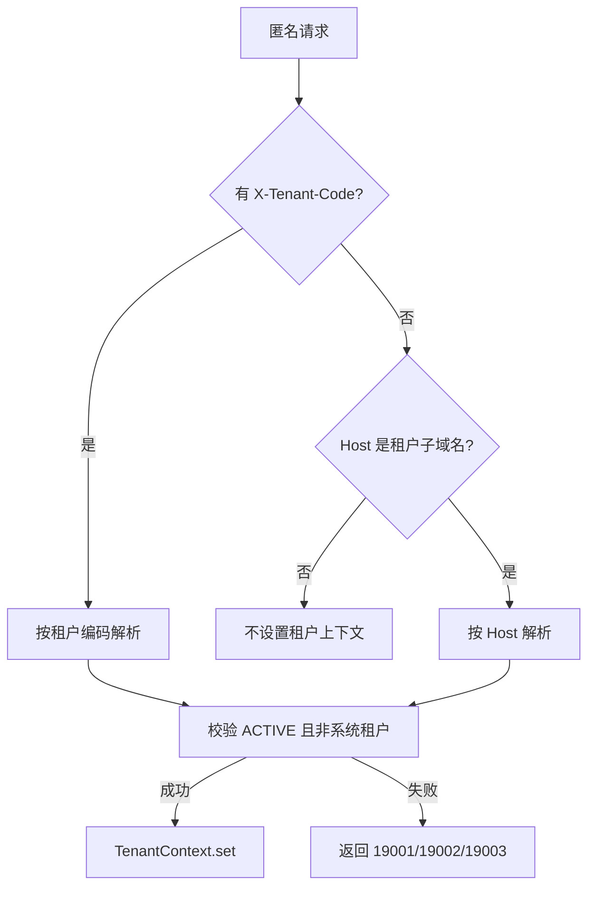
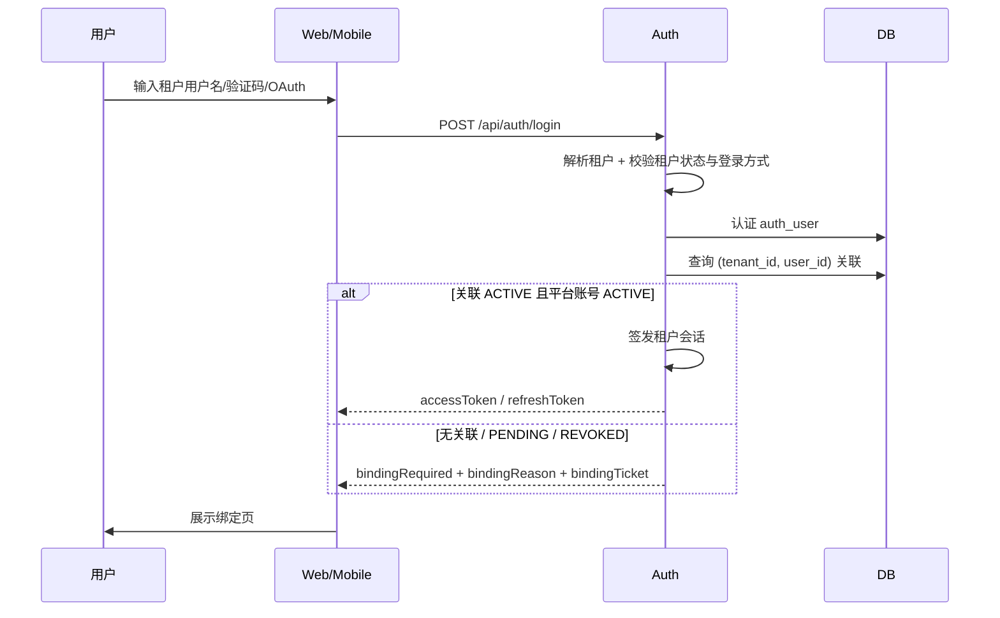

# 多租户设计与实现

本文说明 Nebula 多租户的实际实现链路。源码位置以当前 `../nebula` 仓库为准。

## 1. 代码结构

| 位置 | 职责 |
| --- | --- |
| `nebula-base-common` | `TenantProperties`、`PersonProperties`、`TenantContext`、`TenantDataProvisioner`、`TenantStatusListener` |
| `nebula-base-mybatis` | `TenantTableRegistry`、`NebulaTenantLineHandler`、`TenantBaseEntity`、MyBatis 拦截器注册 |
| `nebula-base-cache` | `TenantAwareCache`、`TenantAwareDynamicTtlCache`、租户缓存前缀 |
| `nebula-base-web` | `NebulaContextTaskExecutor` 传播租户与用户上下文 |
| `nebula-base-cloud` | Feign 入站恢复与出站传播 `X-Tenant-Id` / `X-Tenant-Code` |
| `nebula-auth` | 租户解析、绑定、会话、平台/租户管理接口、租户资源初始化 |
| `nebula-frontend` | `init` 返回当前租户品牌信息 |
| 各业务模块 | 继承 `TenantBaseEntity`、实现 `TenantDataProvisioner`、按需实现 `TenantStatusListener` |
| `web` / `mobile` / `packages/client-sdk` | 子域识别、企业码、绑定挑战、企业切换、租户级推送 |

## 2. 租户解析链路

### 2.1 匿名请求

匿名请求（没有 `Authorization` 头）由 `TenantContextFilter` 解析租户：

1. 读取 `X-Tenant-Code`，存在则按企业编码解析；
2. 否则读取 Host，判断是否为配置的租户子域名；
3. 解析成功写入 `TenantContext`，请求结束后清理；
4. 解析失败直接按统一 `ApiResult` 返回错误，不进入 MVC。



解析规则：

- Host 归一化：小写、去端口、去尾点、IDN 转 punycode、拒绝 IP；
- 只接受 `nebula.tenant.base-domains` 下的**一层**子域名；
- 保留子域名（`auth`、`api`、`www`、`admin`、`login` 等）不会被当作租户；
- `__system__` 系统租户不能作为登录租户，解析时按租户不存在处理；
- `SUSPENDED` / `EXPIRED` / `DELETED` 返回 `19003 TENANT_DISABLED`。

> 匿名场景下 `X-Tenant-Code` 优先于 Host，用于登录页手动输入企业代码；租户子域上的前端默认不传企业码。

### 2.2 已认证请求

携带令牌的请求由 `OpaqueTokenAuthenticationFilter` 处理，`TenantContextFilter` 直接跳过，避免客户端用请求头覆盖令牌所属租户：

1. 从缓存加载 `UserContextDto`；
2. 多租户开启时取会话里的 `tenantId`，缺失则视为无效会话；
3. 在 `TenantContext.runAs(tenantId, ...)` 中刷新用户快照；
4. 重新校验租户与绑定关系（租户 `ACTIVE`、关联 `ACTIVE`、平台账号 `ACTIVE`）；
5. 校验通过后写入 `CurrentUserContext` 与 `TenantContext`。

因此已认证请求的租户来源**只有令牌**，`X-Tenant-Id` 不会被业务代码信任。

## 3. 租户登录与强制绑定

### 3.1 登录流程



关键点：

- 绑定判定**只在租户认证成功后**进行；
- 登录前不查询平台账号，不根据输入的用户名/邮箱/手机号猜测账号是否存在；
- 没有有效绑定时不签发任何租户令牌；
- `PENDING` 只返回等待审批，不签发绑定票据，也不允许再建第二条关联。

### 3.2 判定结果

| 关联状态 | 平台账号状态 | 结果 |
| --- | --- | --- |
| 无记录 | — | `bindingReason=NO_LINK`，签发绑定票据 |
| `PENDING` | 任意 | `bindingReason=LINK_PENDING`、`pendingApproval=true`，不签发票据 |
| `REVOKED` | 任意 | `bindingReason=LINK_REVOKED`，签发绑定票据，完成后更新原记录 |
| `ACTIVE` | `ACTIVE` | 绑定有效，签发租户会话 |
| `ACTIVE` | `DISABLED`/`LOCKED` | `19012 PERSON_DISABLED`，不签发令牌，也不能通过重新绑定绕过 |

## 4. 绑定票据与绑定动作

- 票据缓存在 `bindingTicketCache`（全局缓存），默认 TTL 600 秒，可通过 `nebula.person.binding-ticket-ttl-seconds` 调整；
- 票据只包含 `tenantId`、`userId`、`loginType`、预填资料等，不包含密码或验证码；
- 服务端从票据恢复租户与用户，请求体中的 `tenantId` / `userId` 一律忽略；
- 票据与发起登录的租户绑定，不能拿到其他租户使用；
- 绑定成功或转为 `PENDING` 后删除票据，避免重放。

绑定页提供两个显式动作：

| 动作 | 行为 |
| --- | --- |
| `CREATE_NEW`（默认） | 以租户用户名为建议值创建平台账号；用户名全局冲突返回 `19009` |
| `BIND_EXISTING` | 服务端独立校验已有平台账号凭据（用户名密码 / 邮箱验证码 / 手机验证码）后建立关联 |

`CREATE_NEW` 的约束：

- 用户名重新格式化与校验：小写、3–32 位、字母开头、只允许 ASCII 字母/数字/`.`/`_`/`-`；
- 必须设置平台密码，长度按登录配置校验，不能复用租户密码；
- 邮箱/手机号只有在平台绑定专用验证码通过后才写入，并置 `email_verified` / `phone_verified`；
- 平台账号已存在但无本租户关联时，仍然返回 `NO_LINK`，不自动关联；
- 同一平台账号已关联本租户其他用户时返回 `19018`。

`BIND_EXISTING` 的约束：

- 租户密码、租户验证码、租户 OAuth 结果不能作为平台账号凭据；
- 已有平台账号的邮箱/手机号不会被租户预填值合并；
- 平台账号被禁用返回 `19012`。

## 5. 会话内容与切换

租户会话的 `UserContextDto` 增加：

```text
tenantId, tenantCode, tenantName,
personId,
platformAdmin
```

- `platformAdmin` 来自绑定的 `auth_person.platform_admin`；
- 刷新令牌时重新校验租户状态与绑定关系；
- 租户会话缓存是**全局缓存**，key 为令牌本身，租户信息存在会话值里。

切换企业不做令牌交换：

```text
点击“切换到 beta”
  → 导航到 https://beta.<base>/
  → 目标子域有有效令牌：直接进入
  → 没有或过期且无法刷新：进入该租户登录页
```

Web 端每个子域独立使用 `localStorage` 存令牌；Mobile 同一时刻只保留一个租户会话，切换企业先注销旧租户推送、清理本地会话，再以新企业代码重新登录。

## 6. 数据隔离

### 6.1 MyBatis 拦截器

- `TenantLineInnerInterceptor` 在 `PaginationInnerInterceptor` **之前**注册；
- 只有 `nebula.tenant.enabled=true` 才注册租户插件；
- 租户表查询自动追加 `tenant_id = ?`，插入自动补齐列（实体已带列时 `ignoreInsert` 不再重复注入）；
- 无租户上下文访问租户表抛 `01030001 TENANT_CONTEXT_MISSING`。

### 6.2 表分类

`TenantTableRegistry` 维护两张表清单：

- **GLOBAL**：`auth_tenant`、`auth_tenant_domain`、`auth_person`、`auth_person_user`、`auth_oauth2_provider`、`frontend_app_release`，以及 `QRTZ_*`；
- **TENANT**：业务表（`auth_user`、`auth_role`、`auth_menu`、`sys_param`、`sys_dict_*`、`sys_notify_*`、`storage_*`、`scheduler_*`、`audit_record`、`event_*`、`frontend_user_preference` 等）。

`strict=true` 时启动校验所有 MyBatis 实体表都已分类，未分类直接启动失败；`strict=false` 时未分类表按全局表处理并打 WARN。完整清单见 [建表与数据模型](./ddl.md)。

### 6.3 实体与手写 SQL

- 租户表实体继承 `TenantBaseEntity`，`tenant_id` 由 `FieldFill.INSERT` 自动填充；
- 全局表实体继承 `BaseEntity`；
- 手写 SQL、注解 SQL、原生 JDBC 不会被拦截器改写，必须显式带 `tenant_id`；
- `auth_person_user` 是全局表但含 `tenant_id`，禁止让拦截器自动填充/过滤，租户侧查询必须显式带条件。

### 6.4 查询语义

- 租户表查不到就是没有，**运行时不回退系统租户**；
- 系统租户只作为新建租户的模板源；
- 平台级参数（验证码通道、存储后端）只写在默认租户，不复制到其他租户；
- 租户级参数由 `SystemParamDefinitions` 在新建租户时物化为该租户自己的行。

## 7. 缓存隔离

- 未显式登记为全局的缓存自动加 `{tenantId}::` 前缀（`TenantAwareCache` / `TenantAwareDynamicTtlCache`）；
- 全局缓存通过 `nebula.tenant.ignore-caches` 登记，默认包括会话、绑定票据、OAuth state、登录失败/验证码/找回密码、租户域名解析等；
- 全局缓存的 key 本身已是高熵一次性值，且读取发生在租户上下文建立之前，不能加租户前缀；
- `RedisDynamicTtlCache` 与 Spring `RedisCacheManager` 两条路径规则一致。

## 8. 异步、事件、调度与存储

| 场景 | 实现 |
| --- | --- |
| `@Async` | `NebulaContextTaskExecutor` 捕获并恢复 `TenantContext`、用户上下文、请求上下文 |
| 本地事件 | 发布时记录当前 `tenantId`，分发时 `TenantContext.runAs(event.tenantId, ...)` |
| 远程事件/Outbox | envelope 带 `tenantId`；relay 用 `TenantContext.ignore` 扫描，逐条恢复租户 |
| 幂等 | 消费幂等键带 `tenant_id` |
| 调度 | 任务记录带 `tenant_id`；执行前校验租户状态，租户不可用时跳过并记录 `SKIPPED` |
| 租户状态联动 | `TenantStatusListener` 在事务提交后暂停/恢复该租户的调度任务 |
| 存储 | key 前缀 `t/{tenantId}/`；去重、秒传、签名下载都限定在租户内；`storage_content` 带 `tenant_id` |
| 审计 | 记录 `tenant_id`、`person_id`、`operator_tenant_id`、`target_tenant_id` |
| 服务调用 | 出站 Feign 传播租户头；入站 `UserContextFilter` 恢复租户，已认证请求仍以令牌为准 |

## 9. 租户开通

平台管理员创建租户时，`PlatformTenantServiceImpl.create` 在一个事务内完成：

1. 校验并归一化租户编码（`^[a-z][a-z0-9-]{1,31}$`，不能是保留子域）；
2. 写入 `auth_tenant`，状态 `ACTIVE`；
3. 如传了子域名，写入 `auth_tenant_domain`；
4. 调用 `TenantResourceProvisioner`，在目标租户上下文中从系统租户复制模板；
5. 覆盖管理员账号信息（用户名、密码、昵称、邮箱、手机号）；
6. 提交事务；状态联动在提交后执行。

`TenantResourceProvisioner` 复制：

- 组织、角色、管理员账号；
- user-role、user-org 关联；
- 菜单、按钮、API 目录；
- 角色/用户/组织对资源的授权；
- 然后调用各模块的 `TenantDataProvisioner`（字典、通知、参数）。

复制时重新映射所有 ID，复制完成后各租户数据自包含，运行时不再依赖系统租户。根组织名称替换为新租户名称，管理员默认 `admin / 123456`，创建参数可覆盖。

初始化数据中有两个特殊租户：

| 租户 | 用途 |
| --- | --- |
| `__system__` / `system` | 纯模板命名空间，不分配域名，不能登录 |
| 固定 ID / `default` | 第一个真实租户，同时是主租户；平台管理员归属这里 |

默认租户受保护：不能暂停、不能删除（`19021 DEFAULT_TENANT_PROTECTED`）。

## 10. 平台管理员边界

平台管理员不使用独立会话，判定条件是同时满足：

1. 当前租户会话绑定的平台账号 `platform_admin=true`；
2. 当前租户是配置的默认租户。

`PlatformAdminGuard` 统一校验上述条件。平台管理员能力包括租户管理、子域名、provider 目录、跨租户代配 OAuth；没有跨租户代登录、没有只读旁路、不能读取密码或 OAuth secret。

租户管理员只能操作当前租户；`TenantSettingsController` 允许平台管理员或当前租户 `ADMIN` 角色读写设置。租户 OAuth 配置中，平台管理员可通过查询参数显式指定目标租户，租户管理员只能操作当前租户。

## 11. 关键源码索引

```text
nebula-base/nebula-base-common/.../config/TenantProperties.java
nebula-base/nebula-base-common/.../config/PersonProperties.java
nebula-base/nebula-base-common/.../context/TenantContext.java
nebula-base/nebula-base-mybatis/.../tenant/TenantTableRegistry.java
nebula-base/nebula-base-mybatis/.../tenant/NebulaTenantLineHandler.java
nebula-base/nebula-base-cache/.../tenant/TenantAwareCache.java
nebula-base/nebula-base-web/.../config/NebulaContextTaskExecutor.java
nebula-base/nebula-base-cloud/.../filter/UserContextFilter.java
nebula-auth/nebula-auth-core/.../security/TenantContextFilter.java
nebula-auth/nebula-auth-core/.../security/PlatformAdminGuard.java
nebula-auth/nebula-auth-core/.../service/TenantResolver.java
nebula-auth/nebula-auth-core/.../service/PersonBindingService.java
nebula-auth/nebula-auth-core/.../service/impl/DefaultLoginSessionService.java
nebula-auth/nebula-auth-core/.../service/impl/PlatformTenantServiceImpl.java
nebula-auth/nebula-auth-core/.../service/impl/TenantResourceProvisioner.java
```
