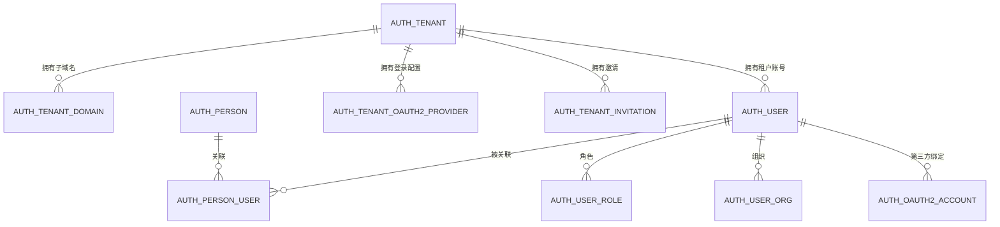

# 多租户模块总览

## 1. 模块定位

Nebula 的多租户不是简单地给每张表加一个 `tenant_id`，而是把“人”和“人在企业里的身份”拆成两层：

- **平台账号（`auth_person`）**：全局身份，只回答“你是谁”，不携带任何租户权限；
- **租户账号（`auth_user`）**：租户内身份，回答“你在该租户是谁、有什么角色和组织”；
- **关联（`auth_person_user`）**：把两者连起来，只有在关联为 `ACTIVE` 且平台账号为 `ACTIVE` 时才算有效绑定。

在此之上，每个租户拥有独立子域名、独立用户/角色/组织/菜单/权限资源，以及独立的字典、参数、通知、文件、审计与调度数据。

多租户默认关闭。`nebula.tenant.enabled=false` 时整套租户链路不参与运行，保持原有单租户登录行为；开启后平台账号层随之启用，并强制绑定。

## 2. 核心概念

| 概念 | 载体 | 说明 |
| --- | --- | --- |
| 租户 | `auth_tenant` | 企业/组织，多租户隔离边界 |
| 租户编码 | `auth_tenant.code` | 公开、不可变，可下发给用户；也用于移动端输入企业代码 |
| 租户子域名 | `auth_tenant_domain.domain` | 如 `acme.app.example.com`，Web 端租户识别依据 |
| 平台账号 | `auth_person` | 全局身份；用户名、邮箱、手机号全局唯一 |
| 租户账号 | `auth_user` | 租户内身份；角色、组织、权限只挂在这里 |
| 平台账号-租户账号关联 | `auth_person_user` | `PENDING / ACTIVE / REVOKED` 三种状态 |
| 系统租户 | `auth_tenant.id = __system__` | 纯模板命名空间，不是可登录客户租户，不分配域名 |
| 默认租户 | 初始化数据固定 ID，`code = default` | 第一个真实客户租户，同时是平台主租户 |
| 主租户 | 默认租户 | 平台级配置（验证码通道、存储后端）与平台管理员归属该租户 |

## 3. 身份模型

三条不能破坏的约束：

1. **平台账号不带权限。** 角色、组织、菜单、按钮、接口权限、数据范围全部挂在 `auth_user` 上。
2. **绑定只认数据库事实。** 唯一判定条件是 `(tenant_id, user_id)` 存在 `ACTIVE` 关联，且对应 `auth_person.status = ACTIVE`；同名、同邮箱、同手机号都不触发自动关联。
3. **切换企业不是换令牌。** 切换 = 导航到目标租户子域名；目标子域有自己的租户令牌，没有就重新登录。

## 4. 运行时隔离范围

| 层面 | 隔离方式 |
| --- | --- |
| 数据库 | MyBatis-Plus `TenantLineInnerInterceptor` 自动给租户表追加 `tenant_id = ?`；全局表放行 |
| 实体 | 租户表实体继承 `TenantBaseEntity`，插入时自动填充 `tenant_id` |
| 缓存 | 未登记为全局的缓存自动加 `{tenantId}:` 前缀 |
| 线程上下文 | `TenantContext`（ThreadLocal）；异步执行器显式传播 |
| 领域事件 | 事件 envelope 携带 `tenantId`，消费前 `TenantContext.runAs` |
| Outbox | 扫描使用 `TenantContext.ignore`，逐条按事件租户恢复上下文 |
| 调度 | 任务数据带租户，租户不可用时暂停该租户全部任务 |
| 文件存储 | 对象 key 前缀 `t/{tenantId}/`；`storage_content` 带 `tenant_id` |
| 审计 | `audit_record` 带 `tenant_id`、`person_id`、`target_tenant_id` |
| 服务调用 | 内部请求传播 `X-Tenant-Id` / `X-Tenant-Code`；已认证请求以令牌租户为准 |
| 前端令牌 | 每个租户子域独立存储自己的令牌，不跨子域共享 |

## 5. 主要能力

- **租户解析**：Host 子域名、企业代码两种来源；系统租户不能被解析为登录租户
- **强制绑定**：租户认证成功后判定关联；无有效绑定返回绑定挑战，不签发令牌
- **平台账号自助**：资料、密码、邮箱/手机号绑定、我的企业、绑定关系、退出所有企业
- **企业切换**：展示已关联企业并导航到目标子域；不做跨租户换令牌
- **成员邀请**：租户管理员或平台管理员创建邀请，被邀请人接受后建号并绑定
- **租户 OAuth2**：平台维护 provider 目录，租户配置自己的 client_id/secret 与回调
- **平台租户管理**：创建、更新、启停、删除租户；维护子域名；查看邀请
- **租户开通**：从系统租户复制组织、角色、管理员、菜单/按钮/API 与权限，各模块复制自己的模板数据
- **状态联动**：租户停用后暂停调度、撤销会话，恢复后按配置恢复任务

## 6. 与 Auth 模块的关系

多租户的入口、会话与绑定逻辑都在 `nebula-auth`：

- `TenantContextFilter`：匿名请求解析租户；
- `TenantResolver`：Host / 企业码解析；
- `PersonBindingService`：绑定判定、绑定挑战、完成绑定；
- `DefaultLoginSessionService`：签发租户会话并写入 `tenantId/personId/platformAdmin`；
- `PlatformTenantController` / `TenantSettingsController`：平台与租户管理接口；
- `TenantResourceProvisioner`：新租户资源初始化。

租户会话建立后，后续业务模块只依赖 `TenantContext` 与 `TenantBaseEntity`，不需要自己解析租户。

## 7. 单租户兼容

| 配置 | 行为 |
| --- | --- |
| `nebula.tenant.enabled=false` | 不注册租户过滤器/拦截器/缓存前缀；不要求平台账号绑定；保持原登录与数据访问方式 |
| `nebula.tenant.enabled=true` | 启用租户解析、数据隔离、强制绑定；平台账号层自动启用 |

开启前请先阅读 [配置说明](./configuration.md) 与 [建表与数据模型](./ddl.md)；关闭状态与开启状态的数据结构不同，切换不是运行时开关。

## 8. 相关文档

- [Auth 模块](../auth/index.md) - 登录、会话、权限与 OAuth2
- [设计与实现](./design-and-implementation.md) - 本文档对应的实现细节
- [业务功能](./business-capabilities.md) - 面向使用者的能力说明
- [使用方式](./usage-guide.md) - 接入与调用
- [配置说明](./configuration.md) - 配置项与开启步骤
- [建表与数据模型](./ddl.md) - 表结构与数据分类
