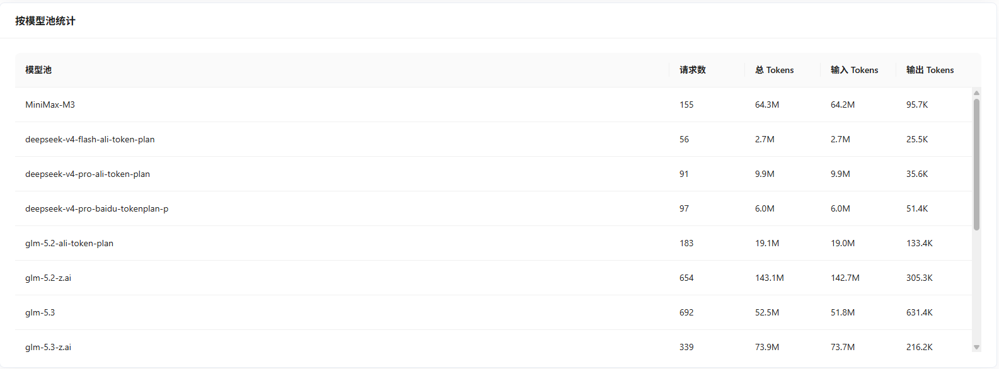
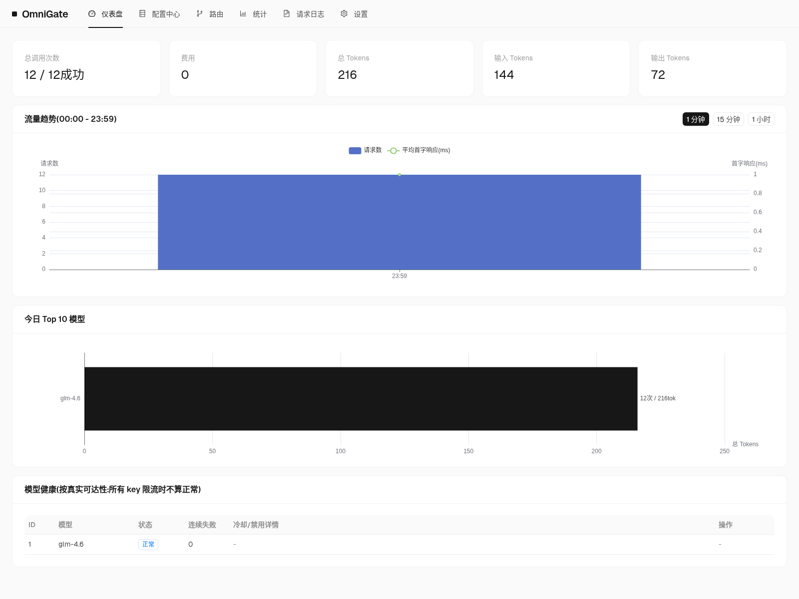
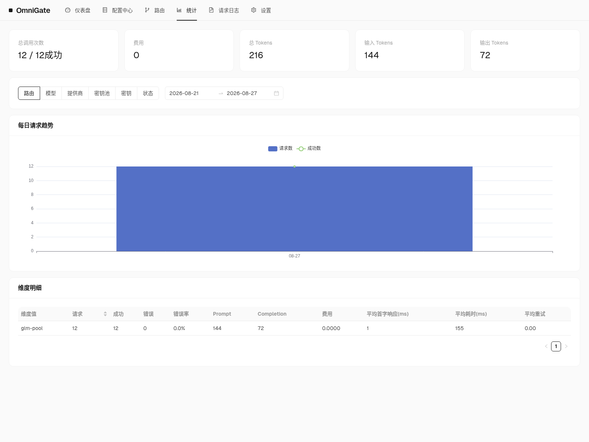

# OmniGate

OpenAI 兼容的 AI 网关。把多个模型提供方聚合成一个端点，提供加权负载均衡、模型内密钥权重、阶梯熔断、虚拟密钥、密钥门户和多维统计，内嵌管理控制台——全部打包在一个静态二进制里。

定位是「本地优先、单二进制、零外部依赖」：纯 Go SQLite（无 CGO），首次运行自动创建 `~/.omnigate/`，不需要单独部署数据库或前端。需要多入口共享状态时，也可以切换到 MySQL / PostgreSQL。

## 从这里开始

| 你是谁 | 建议阅读 |
| --- | --- |
| 第一次使用 | [安装](./getting-started/安装) → [五分钟上手](./getting-started/五分钟上手) |
| 已经装好，准备接入应用 | [接入客户端](./getting-started/接入客户端) → [调用与端点](./guide/调用与端点) |
| 要给团队成员发调用凭证 | [虚拟密钥](./guide/虚拟密钥) → [密钥门户](./guide/密钥门户) |
| 负责部署和长期运行 | [部署形态](./operations/部署形态) → [数据库后端](./operations/数据库后端) → [开机自启](./operations/开机自启) → [版本更新](./operations/版本更新) |
| 想了解内部实现 | [总体架构](./design/总体架构) → [数据模型](./design/数据模型) → [路由与负载均衡](./design/路由与负载均衡) |
| 参与开发 | [本地开发](./development/本地开发) → [测试与质量](./development/测试与质量) → [发布流程](./development/发布流程) |

## 功能特性

| 能力 | 说明 |
| --- | --- |
| OpenAI 兼容代理 | `/v1/chat/completions`（SSE 流式）、`/v1/embeddings`、`/v1/rerank`、`/v1/images/generations`、`/v1/audio/speech`、`/v1/audio/transcriptions`、`/v1/videos`、`/v1/models` |
| 混合协议端点 | `/v1/messages`（Anthropic 原生）、`/v1/responses`（OpenAI Responses 原生）、`/v1/gemini:generateContent`（Gemini 原生）；跨协议转换时 `thinking` 以 `reasoning_content` 透出 |
| MCP 工具网关 | `/v1/mcp/<路由>` 聚合多个 MCP Server；对话测试页可把 MCP 工具注入模型自动调用 |
| 虚拟密钥 | 每小时请求数与并发上限限流、日/月美元限额（超限返回 402）、按路由授权 |
| 密钥门户 | 密钥持有者访问 `/portal` 自助查看用量、模型广场、MCP 与自己的请求日志，全站只读 |
| 两级路由 | 逻辑模型 → 加权选模型 → 模型内密钥按权重分配；也可用 `provider/model` 锁定物理模型 |
| 路由兜底 | 每条路由可配兜底模型，目标全部不可用时单次尝试 |
| 组合熔断 | 禁用粒度精确到 模型×密钥：30s → 1m → 3m 阶梯冷却，连续失败永久禁用；可选定时探测自动解禁 |
| 多维统计 | 次数 / token / 首字延迟 / 总耗时 / 费用，按路由、模型、提供方、密钥、虚拟密钥聚合 |
| 配额告警 | 跨阈值与用满额度时推送 Webhook / 飞书 / 钉钉 / 企业微信 / Slack；站内通知中心记录模型禁用/恢复与外发失败 |
| 内嵌管理台 | React 18 + Ant Design 5，`go:embed` 嵌入二进制，无独立前端部署 |
| 多数据库 | SQLite 默认；可切 MySQL / PostgreSQL，多入口共用一套状态 |
| 开机自启与自更新 | systemd / LaunchAgent / Windows 注册表；管理台或 CLI 一键更新 |

| 仪表盘 | 统计 |
| --- | --- |
|  |  |

## 仓库与安装包

- 代码仓库：[https://github.com/yunqilee69/OmniGate](https://github.com/yunqilee69/OmniGate)
- npm 包：[`@cloudomni/omnigate`](https://www.npmjs.com/package/@cloudomni/omnigate)
- 发布产物：[GitHub Releases](https://github.com/yunqilee69/OmniGate/releases)

默认监听 `127.0.0.1:17777`。需要局域网访问时把启动层配置里的 `host` 改成 `0.0.0.0`，见 [启动层配置](./guide/启动层配置)。
