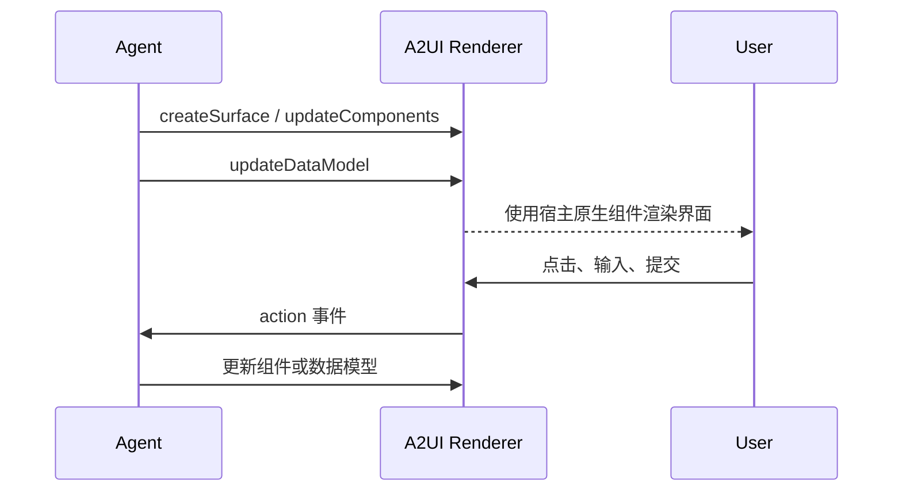
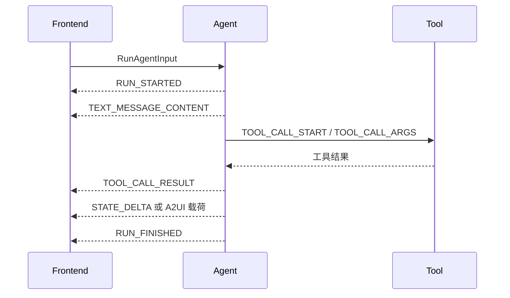
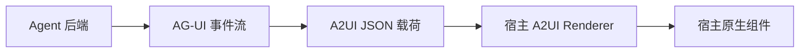

# A2UI、AG-UI 与 ChatGPT Apps

## 先说结论

把这几个概念放在同一张图里，可以这样理解：

| 层次 | 协议或机制 | 解决的问题 |
| --- | --- | --- |
| Agent 与前端通信 | **AG-UI** | Agent 如何把文本、工具调用、状态变化和用户交互以事件流发送给前端 |
| Agent 生成界面 | **A2UI** | Agent 如何用声明式 JSON 描述界面结构、数据绑定和交互动作 |
| 宿主中的应用界面 | **MCP Apps** | MCP 工具如何向宿主提供 HTML UI 资源，以及宿主如何在隔离环境中加载它 |

因此，A2UI 和 AG-UI 不是同一层面的竞品：A2UI 更接近“界面描述协议”，AG-UI 更接近“Agent 与用户应用之间的事件通信协议”。A2UI 可以通过 AG-UI 传输，但也可以绑定到 A2A、MCP、SSE、WebSocket 等其他传输方式。

## A2UI 是什么

A2UI（Agent-to-User Interface）是 Google 发起并开源、采用 Apache 2.0 许可的声明式 UI 协议。它的目标是让 Agent 动态生成可交互界面，而不是让模型直接输出 HTML、JavaScript 或一段需要执行的代码。

A2UI 的基本过程如下：

1. Agent 发送一组 JSON 消息，描述 UI surface、组件、数据模型和后续更新。
2. 客户端根据自己的组件目录（catalog）校验这些描述。
3. 客户端把抽象组件映射为 Web、移动端或桌面端的原生组件。
4. 用户点击按钮或提交表单后，客户端通过 action 等事件把交互结果返回给 Agent。

A2UI v1.0 的 Agent 到 Renderer 消息包括 `createSurface`、`updateComponents`、`updateDataModel`、`deleteSurface`，还支持函数调用相关消息。这里的“流”指 JSON 消息可以逐条到达并渐进渲染，不代表 A2UI 本身规定必须使用 SSE。

### A2UI 的关键边界

- **它不是 HTML/JavaScript 下发协议**：客户端只允许使用自己支持的组件目录，避免直接执行 Agent 生成的任意代码。
- **它不是传输协议**：A2UI 规定消息结构和 Agent 与 Renderer 的语义契约，具体可以由 AG-UI、A2A、MCP、SSE 或 WebSocket 承载。
- **它不是固定视觉主题**：Renderer 使用宿主自己的组件、样式和可访问性实现，因此同一份界面描述可以适配不同客户端。
- **它可以由工具结果触发，但不局限于工具结果**：Agent 可以主动生成界面描述，工具输出也可以成为界面的数据来源。

## AG-UI 是什么

AG-UI（Agent-User Interaction Protocol）是一个开放、轻量、事件驱动的协议，用于连接用户侧应用和 Agent 后端。它定义的是运行时通信和交互事件，不是某一种 UI 组件树格式。

典型交互可以抽象为“一次运行请求进入，一条有序事件流返回”：

AG-UI 的事件族通常包括生命周期、文本消息、工具调用、状态、推理、子 Agent、原始事件和自定义事件。例如：

| 事件 | 前端可以做什么 |
| --- | --- |
| `RUN_STARTED` / `RUN_FINISHED` | 创建和关闭一次 Agent 运行状态 |
| `TEXT_MESSAGE_CONTENT` | 增量显示模型文本 |
| `TOOL_CALL_START` / `TOOL_CALL_RESULT` | 展示工具执行进度和结果 |
| `STATE_SNAPSHOT` / `STATE_DELTA` | 同步 Agent 状态 |
| `RAW` / `CUSTOM` | 承载框架或业务自定义事件 |

因此，“AG-UI 是前端调用接口后得到的结果格式”只说对了一部分。更准确的说法是：前端通过某个传输通道向 Agent 发起运行请求，Agent 按 AG-UI 约定持续返回有类型、可排序的事件；HTTP+SSE 是常见绑定，但 AG-UI 的核心是事件模型，不是某个固定 URL 或单个 JSON 响应。

## A2UI 和 AG-UI 如何配合

可以把一次带有动态界面的 Agent 运行拆成三层：

在这个组合中：

- AG-UI 负责传递运行生命周期、文本、工具调用、状态和交互事件。
- A2UI 负责描述某一个 UI surface 的组件、数据和动作。
- 前端应用负责把 A2UI 描述映射到自己的 React、Flutter、SwiftUI、Jetpack Compose 或其他组件实现。

A2UI 不一定要被包装成“工具结果”。例如，Agent 可以在工具执行后发送一条带 A2UI 数据的自定义事件，也可以把它作为某种生成式 UI 载荷独立传给 Renderer。具体载荷如何挂接，取决于所采用的 AG-UI 集成方式和客户端约定。

## ChatGPT Apps 是否使用 A2UI

不能仅凭“对话区域出现了交互界面”就判断 ChatGPT 使用了 A2UI。当前更准确的判断是：ChatGPT Apps 采用 MCP Apps 这类 UI 集成方式，MCP Server 为工具声明 UI 资源，宿主在沙盒 iframe 中加载 HTML，并通过 `postMessage` 上的 JSON-RPC 桥与宿主通信。

这与 A2UI 的默认模型不同：

| 对比项 | A2UI | ChatGPT Apps / MCP Apps |
| --- | --- | --- |
| Agent 提供的内容 | 声明式 JSON 组件和数据模型 | `ui://` 等资源指向的 HTML/JavaScript UI |
| 主要渲染方式 | 宿主映射到自己的原生组件 | 宿主在隔离的 iframe 中加载应用资源 |
| 交互通道 | A2UI action 等 Renderer-to-Agent 消息 | MCP Apps UI bridge、`postMessage` 和 JSON-RPC |
| 与另一方的关系 | 可作为界面描述层 | 可作为宿主承载 A2UI Renderer 的容器 |

所以，下面这句话不够准确：

> ChatGPT 的插件利用 A2UI 在对话区域显示界面。

更稳妥的表述是：

> ChatGPT 的 Apps UI 主要遵循 MCP Apps 的 HTML iframe 与宿主桥接模型，不应直接断言为 ChatGPT 原生渲染 A2UI。若 MCP App 自己打包 A2UI Renderer，并把 A2UI JSON 交给该 Renderer 处理，那么应用内部可以使用 A2UI；这属于集成方式，不代表 ChatGPT 宿主原生支持 A2UI。

这里还要区分两个事实：

- “对话区域有界面”只说明宿主支持某种 UI 扩展，不能反推出具体使用了哪一个生成式 UI 协议。
- 工具结果可以包含结构化数据，也可以关联 UI 资源；结构化工具结果本身不自动等于 A2UI。

## 一句话记忆

> **AG-UI 负责 Agent 与前端如何实时通信，A2UI 负责界面描述成什么样，MCP Apps 负责 MCP 工具如何把一个隔离的 HTML 应用交给宿主。**

## 官方资料

- [A2UI v1.0 Protocol Specification](https://a2ui.org/specification/v1.0-a2ui/)
- [A2UI 项目仓库](https://github.com/a2ui-project/a2ui)
- [AG-UI Overview](https://docs.ag-ui.com/introduction)
- [AG-UI Events](https://docs.ag-ui.com/concepts/events)
- [AG-UI Generative UI](https://docs.ag-ui.com/concepts/generative-ui-specs)
- [OpenAI：为 MCP Server 添加 UI](https://developers.openai.com/plugins/build/chatgpt-ui)
- [MCP Apps Overview](https://modelcontextprotocol.io/extensions/apps/overview)
