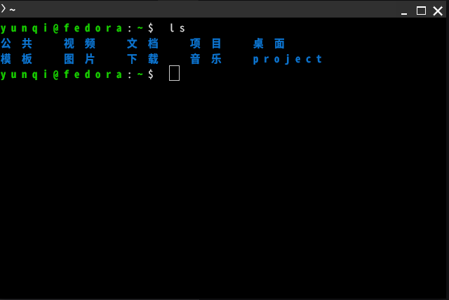
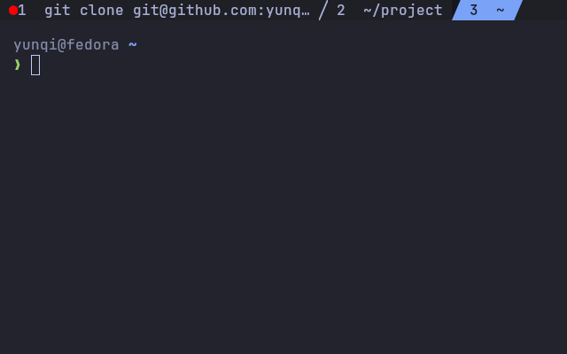

# kitty 终端安装与配置

从系统默认终端换成 kitty 的完整步骤：安装、字体下载与安装、配置文件写入、快捷键、常见问题与效果对比。文档中的命令可以按顺序直接复制执行，不需要额外查资料。X11 与 Wayland 桌面环境通用。

验证环境：Fedora 45 + GNOME Wayland，kitty 0.48.2，Nerd Fonts v3.5.1。

## 为什么用 kitty

- GPU 渲染，输出几十万行日志时不卡顿；相比 VTE 系终端（GNOME Terminal、Ptyxis）滚动和刷新差异明显
- 标签、分屏、连字、真彩色、图片协议、剪贴板支持都是内置的，不需要插件
- `kitten ssh` 会自动把本地 kitty 配置和 terminfo 推送到远端，SSH 登录后远端窗口的鼠标、滚轮、图标可直接使用
- 配置是单个文本文件，`include` 拆分主题，改完 `ctrl+shift+f5` 热重载

代价：没有图形化设置界面，快捷键需要记；配置文件语法有几处反直觉的地方，见[常见问题](#常见问题)。

## 安装

各发行版的包名与命令：

| 发行版 | 安装命令 |
| --- | --- |
| Fedora / RHEL | `sudo dnf install kitty` |
| Debian / Ubuntu | `sudo apt install kitty` |
| Arch / Manjaro | `sudo pacman -S kitty` |
| openSUSE | `sudo zypper install kitty` |

装完确认版本（0.40 以上都支持本文用到的全部配置项）：

```bash
kitty --version
```

如果发行版仓库版本过旧（Debian 稳定版常见），改用官方安装脚本：

```bash
curl -L https://sw.kovidgoyal.net/kitty/installer.sh | sh /dev/stdin
```

### 设置启动快捷键

GNOME 默认没有给终端分配全局快捷键，需要自己加一条自定义快捷键（`设置` → `键盘` → `查看及自定义快捷键` → `自定义快捷键`），名称填 `Kitty`，命令填 `kitty`，快捷键按需指定（例如 `Alt+T`）。

命令行等价写法：

```bash
gsettings set org.gnome.settings-daemon.plugins.media-keys custom-keybindings \
  "['/org/gnome/settings-daemon/plugins/media-keys/custom-keybindings/custom0/']"

KEY=/org/gnome/settings-daemon/plugins/media-keys/custom-keybindings/custom0/
gsettings set org.gnome.settings-daemon.plugins.media-keys.custom-keybinding:$KEY name 'Kitty'
gsettings set org.gnome.settings-daemon.plugins.media-keys.custom-keybinding:$KEY command 'kitty'
gsettings set org.gnome.settings-daemon.plugins.media-keys.custom-keybinding:$KEY binding '<Alt>t'
```

> 💡 **注意**：`Alt+T` 在部分应用里是自带菜单键（例如浏览器），如果出现抢占，改用 `<Control><Alt>t` 或 `<Super>t`。

## 字体

### 只装一套：Nerd Font

终端字体有两个层次的需求：

1. **等宽正文字体**：决定代码和日志的观感
2. **Nerd Font 图标字形**：powerline 分隔符、git 分支图标等符号

发行版仓库里的 `jetbrains-mono-fonts` 只满足第 1 点，第 2 点需要 Nerd Font，而**各发行版仓库都没有打包 Nerd Font**，必须从 GitHub Releases 手动下载。

Nerd Font 里的 `JetBrainsMono Nerd Font Mono` 是「JetBrains Mono + 图标字形」的合并版，装它一套就同时满足两点，不需要再单独装 `jetbrains-mono-fonts`。

### 下载

官方地址（当前可选版本 v3.5.1，换了版本只改 URL 里的版本号）：

```bash
# 国内访问 GitHub 慢或超时，用镜像前缀 https://ghfast.top/ 加速
curl -L -o JetBrainsMono.zip \
  https://ghfast.top/https://github.com/ryanoasis/nerd-fonts/releases/download/v3.5.1/JetBrainsMono.zip

# 网络畅通时可走官方直连
curl -L -o JetBrainsMono.zip \
  https://github.com/ryanoasis/nerd-fonts/releases/download/v3.5.1/JetBrainsMono.zip
```

- 压缩包约 128 MB，包含 96 个 TTF（普通版 / `Mono` / `Propo` 三套 × 多种字重 × 带不带连字两版）
- 版本列表与全部字体：[nerd-fonts releases](https://github.com/ryanoasis/nerd-fonts/releases)

### 安装

> 💡 解压需要 `unzip`：`sudo dnf install unzip`（Debian 系 `sudo apt install unzip`）。字体装到用户目录，不需要 root。

只解压终端需要的 `Mono` 变体的 4 个字重，避免字体选择列表被上百个文件塞满：

```bash
mkdir -p ~/.local/share/fonts/JetBrainsMonoNerdFontMono

unzip -o JetBrainsMono.zip \
  'JetBrainsMonoNerdFontMono-Regular.ttf' \
  'JetBrainsMonoNerdFontMono-Bold.ttf' \
  'JetBrainsMonoNerdFontMono-Italic.ttf' \
  'JetBrainsMonoNerdFontMono-BoldItalic.ttf' \
  -d ~/.local/share/fonts/JetBrainsMonoNerdFontMono

fc-cache -f
```

验证 fontconfig 能命中，输出应类似：

```bash
fc-match "JetBrainsMono Nerd Font Mono"
# JetBrainsMonoNerdFontMono-Regular.ttf: "JetBrainsMono Nerd Font Mono" "Regular"

fc-match "JetBrainsMono Nerd Font Mono:bold"
# JetBrainsMonoNerdFontMono-Bold.ttf: "JetBrainsMono Nerd Font Mono" "Bold"
```

进一步确认图标字形已包含（`e0a0-e0c8` 是 powerline 与分支图标所在的区段）：

```bash
fc-match -f '%{charset}\n' "JetBrainsMono Nerd Font Mono" | tr ' ' '\n' | grep -E '^e0'
# e000-e00a
# e0a0-e0a3
# e0b0-e0c8
```

也可以直接目视检查，终端里能看到 powerline 三角、git 分支图标和文件夹图标就说明字形完整：

```bash
printf '\ue0b0 \ue0b2 \ue725 \uf07b\n'
```

### 为什么选 Mono 变体

Nerd Font v3 每个字体都有三套：普通版、`Mono`、`Propo`。

- `Mono`：图标字形强制单字符宽，正好等于终端里一个格子
- 普通版 / `Propo`：图标为双宽或按比例排布，放进 powerline 标签栏会出现接缝错位、光标位置跳格

因此终端统一使用 `JetBrainsMono Nerd Font Mono`。`Mono` 只影响图标宽度，**连字（ligature）依然保留**。

> 💡 **只想用官方仓库字体、不需要图标**：`sudo dnf install jetbrains-mono-fonts`，然后把配置里的 `font_family` 改成 `JetBrains Mono`，并把 `tab_bar_style` 从 `powerline` 改成 `fade`（powerline 依赖图标字形，没有 Nerd Font 会显示成方块）。

## 配置文件

配置目录为 `~/.config/kitty/`，拆成主配置 + 两个主题文件，换肤时只改一行 `include`：

```text
~/.config/kitty/
├── kitty.conf                     # 主配置
├── theme-tokyonight.conf          # Tokyo Night 配色（当前使用）
└── theme-catppuccin-mocha.conf    # Catppuccin Mocha 配色（备选）
```

### 一次性写入三个文件

按顺序执行，得到下文说明的完整配置：

```bash
mkdir -p ~/.config/kitty

cat > ~/.config/kitty/theme-tokyonight.conf <<'EOF'
background            #1a1b26
foreground            #c0caf5
selection_background  #283457
selection_foreground  #c0caf5
cursor                #c0caf5
cursor_text_color     #1a1b26

active_tab_background   #7aa2f7
active_tab_foreground   #1a1b26
inactive_tab_background #16161e
inactive_tab_foreground #a9b1d6
tab_bar_background      #16161e

color0  #15161e
color1  #f7768e
color2  #9ece6a
color3  #e0af68
color4  #7aa2f7
color5  #bb9af7
color6  #7dcfff
color7  #a9b1d6
color8  #414868
color9  #f7768e
color10 #9ece6a
color11 #e0af68
color12 #7aa2f7
color13 #bb9af7
color14 #7dcfff
color15 #c0caf5
EOF

cat > ~/.config/kitty/theme-catppuccin-mocha.conf <<'EOF'
background            #1e1e2e
foreground            #cdd6f4
selection_background  #585b70
selection_foreground  #cdd6f4
cursor                #f5e0dc
cursor_text_color     #1e1e2e

active_tab_background   #89b4fa
active_tab_foreground   #1e1e2e
inactive_tab_background #181825
inactive_tab_foreground #a6adc8
tab_bar_background      #181825

color0  #45475a
color1  #f38ba8
color2  #a6e3a1
color3  #f9e2af
color4  #89b4fa
color5  #f5c2e7
color6  #94e2d5
color7  #bac2de
color8  #585b70
color9  #f38ba8
color10 #a6e3a1
color11 #f9e2af
color12 #89b4fa
color13 #f5c2e7
color14 #94e2d5
color15 #a6adc8
EOF

cat > ~/.config/kitty/kitty.conf <<'EOF'
# 主题：换肤只改这一行
include theme-tokyonight.conf

# 字体
font_family        JetBrainsMono Nerd Font Mono
bold_font          auto
italic_font        auto
font_size          12.0
adjust_line_height 105%
disable_ligatures  never

# 窗口
window_padding_width       10
initial_window_width       1200
initial_window_height      740
background_opacity         0.96
dynamic_background_opacity yes
active_border_color        #7aa2f7
inactive_border_color      #1f2335

# 标签栏
tab_bar_edge            top
tab_bar_min_tabs        1
tab_bar_style           powerline
tab_powerline_style     slanted
tab_title_template      "{index}  {title}"
active_tab_font_style   bold
inactive_tab_font_style normal

# 光标
cursor_shape            beam
cursor_beam_thickness   1.6
cursor_blink_interval   0.6
cursor_trail            3

# 行为
copy_on_select        clipboard
enable_audio_bell     no
scrollback_lines      20000
shell_integration     enabled
update_check_interval 0

# 快捷键
map ctrl+shift+alt+enter launch --location=vsplit --cwd=current
map ctrl+shift+alt+h     neighboring_window left
map ctrl+shift+alt+j     neighboring_window bottom
map ctrl+shift+alt+k     neighboring_window top
map ctrl+shift+alt+l     neighboring_window right
map ctrl+shift+alt+left  resize_window narrower 2
map ctrl+shift+alt+right resize_window wider 2
map ctrl+shift+alt+up    resize_window taller 2
map ctrl+shift+alt+down  resize_window shorter 2
map ctrl+shift+m         toggle_layout stack
map alt+1                goto_tab 1
map alt+2                goto_tab 2
map alt+3                goto_tab 3
EOF
```

> ⚠️ **重要**：kitty 配置**不支持行尾注释**。上面注释全部独占一行，自己加配置时 `#` 之后不要写在同一行，否则整段值会解析失败。

### 关键配置项说明

| 配置项 | 作用 |
| --- | --- |
| `font_family` | 字体家族名，必须与 `fc-match` 输出的名称完全一致（带不带 `Mono` 是两个家族） |
| `adjust_line_height 105%` | 行高略微放松，密排文字更透气 |
| `disable_ligatures never` | 保留编程连字（`->` `=>` `!=`）；不喜欢改成 `always` |
| `window_padding_width 10` | 文字与窗口边缘的留白 |
| `background_opacity 0.96` | 窗口透明度，Wayland 下作用于整个窗口 |
| `dynamic_background_opacity yes` | 允许 `ctrl+shift+a` 实时调整透明度 |
| `tab_bar_style powerline` | 斜角标签栏，可选 `fade` / `slant` / `hidden` |
| `tab_title_template` | 标签标题格式，`{index}` 标签序号、`{title}` 当前程序标题 |
| `cursor_trail 3` | 光标移动拖尾，纯视觉，觉得花可以删掉 |
| `copy_on_select clipboard` | 选中即复制到剪贴板 |
| `shell_integration enabled` | 上报当前目录、标记提示符，新标签/分屏继承工作目录 |
| `update_check_interval 0` | 关闭联网更新检查 |

### 验证配置

配置有语法错误时，kitty 启动会在终端打印 `Ignoring unknown config key` 或 `is not a valid choice`。也可以用 kitty 自带解析器逐行检查坏行：

```bash
kitty +runpy '
from os.path import expanduser
from kitty.config import load_config
bad = []
load_config(expanduser("~/.config/kitty/kitty.conf"), accumulate_bad_lines=bad)
print("坏行:", len(bad))
for b in bad:
    print(b.number, b.line, b.exception)'
```

输出 `坏行: 0` 即配置全部合法。之后新开窗口自动生效，已开的窗口按 `ctrl+shift+f5` 重载。

### 换主题

改 `kitty.conf` 第一行的 `include` 即可，键位和字体不受影响：

```conf
include theme-tokyonight.conf          # 深蓝调，本文默认
# include theme-catppuccin-mocha.conf  # 灰紫调，柔和圆润
```

也可以用 kitty 自带命令浏览/切换内置与社区主题（会自动写入配置文件）：

```bash
kitten themes
```

选字体同样有图形化交互界面，带预览：

```bash
kitten choose-fonts
```

## 快捷键

kitty 默认键位已覆盖常用操作，下表是默认值与本文配置补充后的完整清单：

| 快捷键 | 作用 |
| --- | --- |
| `ctrl+shift+t` | 新标签（继承当前目录） |
| `ctrl+shift+q` / `ctrl+shift+w` | 关闭标签 / 关闭窗口 |
| `ctrl+shift+enter` | 水平分屏 |
| `ctrl+shift+alt+enter` | 垂直分屏 |
| `ctrl+shift+alt+h/j/k/l` | 在分屏间跳转 |
| `ctrl+shift+alt+方向键` | 调整分屏大小 |
| `ctrl+shift+m` | 当前分屏最大化 / 还原 |
| `ctrl+shift+[` / `]` | 上/下一个分屏 |
| `ctrl+shift+←/→` | 上/下一个标签 |
| `alt+1` ~ `alt+3` | 跳到第 1~3 个标签 |
| `ctrl+shift+=` / `-` / `0` | 放大 / 缩小 / 重置字号 |
| `ctrl+shift+h` | 分页查看回滚内容 |
| `ctrl+shift+a` | 实时调节窗口透明度 |
| `ctrl+shift+p` | 命令面板（忘记快捷键时搜索） |
| `ctrl+shift+f5` | 重载配置文件 |

## 常见问题

### 配置里写了注释就报错

见上文「一次性写入三个文件」下方的警告：kitty 配置**不支持行尾注释**，`#` 之后的内容会被当成值的一部分。

```conf
# 错误写法：值会被解析成 "fade   # 无 nerd font 时用这个"
tab_bar_style fade   # 无 nerd font 时用这个

# 正确写法：注释独占一行
# 无 nerd font 时用 fade
tab_bar_style fade
```

### 改了快捷键却触发了两个动作

对已被默认绑定的组合键写 `map` 是**追加**而不是替换，按下会同时执行两个动作。例如 `ctrl+shift+t` 默认绑定 `new_tab`，再 `map` 一次 `new_tab_with_cwd` 会导致一次开两个标签。

改键前先查默认键位，避免撞车：

```bash
kitty +runpy 'from kitty.config import load_config
km = load_config().keyboard_modes[""].keymap
for k, v in sorted(km.items()):
    print(k, [d.definition for d in v])'
```

### 图标显示成方块

说明只有普通版等宽字体、没有 Nerd Font 字形，或者 `font_family` 名字写错（带 `Mono` 和不带 `Mono` 是两个不同家族）。用 `fc-match "JetBrainsMono Nerd Font Mono"` 确认能否命中，命中结果应是 `JetBrainsMonoNerdFontMono-*.ttf`。

### Wayland 下无法隐藏标题栏

`hide_window_decorations` 在新版本已改名为 `x11_hide_window_decorations`，只在 X11 下生效。Wayland 桌面（GNOME、KDE）的窗口装饰由合成器绘制，无法通过 kitty 配置关闭。

### 透明度把文字也变淡了

Wayland 下 `background_opacity` 作用于整个窗口而不是仅背景，数值太低会影响可读性，`0.95` ~ `0.97` 是较为合适的范围。

## 效果对比

配置前：默认纯黑背景、系统默认等宽字体、无标签栏样式。



配置后：Tokyo Night 配色、顶部斜角 powerline 标签栏、JetBrainsMono Nerd Font Mono 等宽字体、窗口内边距与轻微透明。



关键变化项：

| 维度 | 默认 | 配置后 |
| --- | --- | --- |
| 背景 / 前景 | 纯黑 + 默认白 | `#1a1b26` + `#c0caf5` |
| 标签栏 | 无样式，跟随标题栏 | 顶部 powerline 斜角标签，激活色 `#7aa2f7` |
| 字体 | 系统默认等宽 | JetBrainsMono Nerd Font Mono 12pt，带连字 |
| 间距 | 文字贴边 | 10px 内边距，行高 105% |
| 透明度 | 不透明 | `0.96`，`ctrl+shift+a` 可实时调整 |

## 延伸

- **远程连接**：`kitten ssh 用户名@主机`，比 `ssh` 多做「推送本地配置、字体、terminfo 到远端」几步，远端窗口立刻可用
- **会话持久化**：仍然交给 `tmux`，终端只是渲染层，断线恢复不靠它
- **文件传输**：`kitten transfer`，或直接用 `rsync`
- **图形化 SSH 客户端**：需要主机列表管理、内置 SFTP 时，可另选 Tabby、Electron 类客户端等工具

## 相关文档

- [SSH 免密登录](../SSH免密登录)
- [NVM 安装 Node.js](../nvm-nodejs/)
